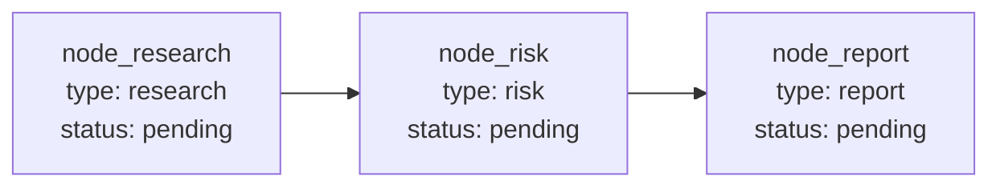
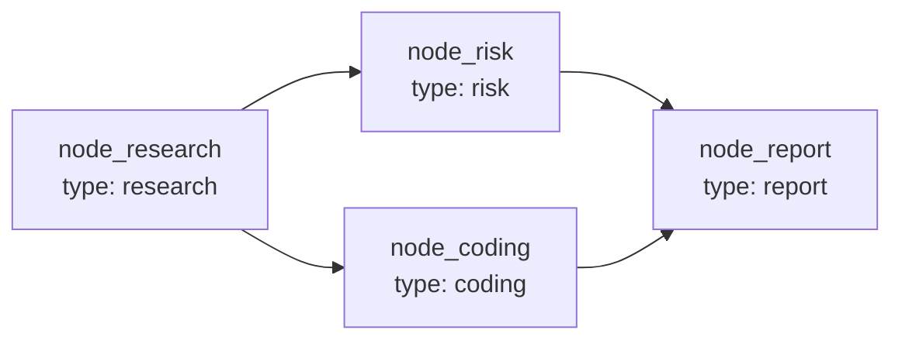
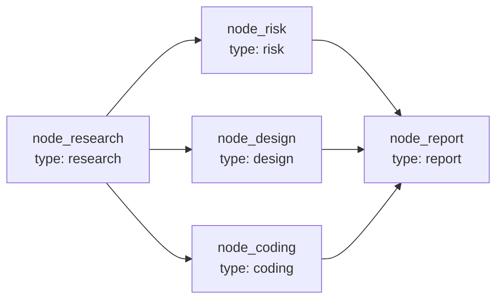

# DAG Decomposition Algorithm

This document explains how the coordinator decomposes a natural language prompt into a directed acyclic graph (DAG) of agent tasks. It covers the decomposition pipeline, node and dependency rules, cycle detection, size limits, ambiguity handling, and debugging.

---

## Table of Contents

1. [Algorithm Overview](#1-algorithm-overview)
2. [Node Creation Rules](#2-node-creation-rules)
3. [Dependency Rules](#3-dependency-rules)
4. [Example DAGs](#4-example-dags)
5. [Cycle Detection](#5-cycle-detection)
6. [Maximum DAG Size Limits](#6-maximum-dag-size-limits)
7. [Handling Ambiguous Prompts](#7-handling-ambiguous-prompts)
8. [Partial Decomposition Fallback](#8-partial-decomposition-fallback)
9. [Debugging Decomposition Failures](#9-debugging-decomposition-failures)

---

## 1. Algorithm Overview

The decomposition runs as a four-stage pipeline every time a task is submitted via `POST /api/tasks`.

### Stage 1 — Prompt Parsing and Intent Extraction

The raw prompt string is lowercased and scanned for capability-indicating keywords. The current keyword map is:

| Capability | Trigger keywords |
|---|---|
| `research` | always included (anchor node) |
| `risk` | `risk`, `market`, `financial` |
| `coding` | `code`, `software`, `implement` |
| `design` | `design`, `ui`, `visual` |
| `report` | always included (terminal node) |

This stage produces a set of required capability labels.

### Stage 2 — Node Construction

One `DAGNode` object is created for each required capability. Each node is assigned a stable `nodeId` (e.g. `node_research`, `node_coding`), a `type` matching the capability label, a human-readable `prompt` and `description`, and an initial `status` of `pending`.

### Stage 3 — Dependency Inference

The algorithm wires dependencies between nodes based on a fixed topology:

- `node_research` has no dependencies — it always runs first.
- Capability nodes (`node_risk`, `node_coding`, `node_design`) each declare `["node_research"]` as their dependency, so they run in parallel once research completes.
- `node_report` depends on all capability nodes that were created. If only `node_research` was created, `node_report` depends on `["node_research"]` directly.

### Stage 4 — DAG Validation and Normalization

After construction the DAG is validated:

- Every `nodeId` referenced in a `dependencies` array must exist in the node list (referential integrity check).
- The graph must be acyclic (DFS-based topological sort — see [§5](#5-cycle-detection)).
- Nodes that have no dependencies other than `node_research` and whose keywords were not matched are dropped to avoid empty work units.

The validated node array is attached to the `Task` object and stored. The raw node list is also returned in the `POST /api/tasks` response as `dagPreview`.

**Entry point:** `backend/src/coordinator/index.ts` → `decompose(taskId, prompt)`  
**Execution engine:** `backend/src/coordinator/coordinator.ts` → `Coordinator.executeDAG()`

---

## 2. Node Creation Rules

**One node per distinct capability.** The algorithm never merges two different capability types into a single node, and never splits a single capability into multiple nodes. The granularity is exactly one node per capability label.

**Minimum node count is two.** Every decomposition produces at least `node_research` and `node_report`, regardless of prompt content.

**Maximum node count per decomposition is six** (one for each of the five supported capabilities plus `node_report`). Prompts that require more than five capabilities need to be split into multiple tasks.

**What causes two related tasks to become one node vs. two nodes:**

- Two tasks become **one node** when they share the same capability label (e.g. two separate coding tasks are both handled by `node_coding`).
- Two tasks become **two nodes** when they require different capability labels (e.g. a coding task and a risk task are separate nodes).

The rationale is that agents are specialized by capability type. The coordinator assigns each node to a registered agent whose `type` matches the node's `type`; a single agent execution handles everything within that capability.

---

## 3. Dependency Rules

A node B depends on node A when any of these conditions holds:

1. **Output reference** — B needs the results produced by A as input context. The coordinator passes `node.result` from completed upstream nodes as the `context` string to the downstream agent.
2. **Implicit ordering** — research must precede all analysis. `node_research` is always the first node in topological order.
3. **Explicit sequencing cue** — `node_report` always runs last. It aggregates output from all other nodes.

**Dependency wiring summary:**

```
node_research  →  node_risk     →
               →  node_coding   →  node_report
               →  node_design   →
```

**Circular dependency candidates** are impossible to produce from the current keyword-based heuristic because the topology is fixed. However, the cycle-detection pass (§5) runs on every graph to guard against future algorithmic changes or manually constructed DAGs submitted via the internal API.

---

## 4. Example DAGs

### 4.1 Market Research Prompt — Linear (3 nodes)

**Prompt:** `"Analyse the financial risk of entering the solar panel market"`

Keyword matches: `financial` → `risk`, `market` → `risk`



Execution order: `node_research` → `node_risk` → `node_report`

---

### 4.2 Code Audit Prompt — Fan-In (4 nodes)

**Prompt:** `"Audit the software for security risks and implement fixes, then write a report"`

Keyword matches: `software` → `coding`, `risk` → `risk`



`node_risk` and `node_coding` run in parallel after `node_research` completes. `node_report` waits for both (fan-in pattern).

---

### 4.3 Complex Business Analysis — Mixed Graph (5 nodes)

**Prompt:** `"Research the market, assess financial risks, design the UI, implement the code, and produce a report"`

Keyword matches: `market` → `risk`, `financial` → `risk`, `design` → `design`, `ui` → `design`, `implement` → `coding`



Three capability nodes run in parallel after `node_research`. `node_report` aggregates all three (3-way fan-in).

---

## 5. Cycle Detection

The coordinator runs a **DFS-based topological sort** on the constructed DAG before execution begins. The algorithm is:

1. For each unvisited node, perform a depth-first traversal following `dependencies`.
2. Track two sets: *visiting* (nodes on the current DFS path) and *visited* (fully processed nodes).
3. If a node is encountered that is already in *visiting*, a cycle exists.

**When a cycle is detected**, `executeDAG` does not start execution. Instead, the task is immediately set to `failed` status and an error event is emitted:

```json
{
  "type": "task_failed",
  "taskId": "task_abc123",
  "timestamp": "2025-01-15T10:23:45.123Z",
  "payload": {
    "error": "Cycle detected in DAG: node_risk → node_report → node_risk"
  }
}
```

The cycle path is included so the caller knows exactly which nodes form the cycle.

**How to fix a cyclic prompt:** Cycles cannot occur from the current keyword-based `decompose()` function. If you encounter a cycle, it means a DAG was constructed manually or programmatically with a circular dependency. Remove the edge that creates the back-reference. In the example above, remove the dependency from `node_report` back to `node_risk`.

---

## 6. Maximum DAG Size Limits

| Limit | Value | Behaviour when exceeded |
|---|---|---|
| Maximum nodes per DAG | **6** | Additional capability keywords are ignored; the first matched set is used |
| Maximum dependencies per node | **5** | Excess dependencies are silently dropped during normalization |
| Maximum prompt length | **2 000 characters** | Request rejected with HTTP 400 `PROMPT_TOO_LONG` |

**How to split large prompts:** Decompose the work into logical phases and submit each phase as a separate task. For example, a 10-capability workflow can be split into two 5-capability tasks where the second task references the output of the first in its prompt.

---

## 7. Handling Ambiguous Prompts

An ambiguous prompt is one where no capability keywords are matched beyond the default anchor (`node_research`).

**Resolution behaviour:**

1. The coordinator still creates `node_research` and `node_report`.
2. `node_report` is wired to depend on `node_research` directly.
3. No capability fallback is applied — the two-node DAG is considered valid.
4. The response `dagPreview` reflects this minimal graph so the caller can inspect it.

If the LLM-driven decomposition path is enabled in a future version and returns an ambiguous result (e.g. an empty capability list), the system falls back to the same two-node minimal DAG and logs a `coordinator.decompose` warning with `reason: "llm_ambiguous_response"`.

---

## 8. Partial Decomposition Fallback

A partial decomposition occurs when some nodes are created but cannot be assigned a registered agent at execution time (not at decomposition time).

**Handling:**

1. The DAG is fully constructed and stored regardless of agent availability.
2. At execution time, `Coordinator.executeDAG()` attempts to dispatch each node when its dependencies are satisfied.
3. If no agent is registered for a node's `type`, the node transitions to `failed` with `error: "No agent registered for type: <type>"`.
4. Downstream nodes whose dependency chain includes the failed node are also marked `failed` with `error: "upstream_failed"`.
5. Nodes that have no failed upstream dependencies continue executing normally.
6. The task finishes with `status: "failed"` if any node fails.

This means a partial graph can still produce useful output: nodes that complete successfully have their results available via `GET /api/tasks/:id`, even if the full workflow did not complete.

---

## 9. Debugging Decomposition Failures

### Log fields to inspect

All decomposition and execution events are logged under the `coordinator.decompose` and `coordinator.execute` namespaces using structured JSON. The key fields are:

| Field | Description |
|---|---|
| `taskId` | The task being processed |
| `totalNodes` | Number of nodes in the constructed DAG |
| `nodeId` | The specific node being executed |
| `agentType` | The capability type of the node |
| `error` | The failure reason |
| `correlationId` | Trace ID for cross-service correlation |

### Extracting the raw decomposition output

Set `LOG_LEVEL=debug` in the backend environment. This emits a `coordinator.decompose` entry at `debug` level immediately after `decompose()` returns, containing the full node list:

```json
{
  "level": "debug",
  "time": "2025-01-15T10:23:44.001Z",
  "component": "coordinator",
  "event": "coordinator.decompose",
  "taskId": "task_abc123",
  "prompt": "Analyse the financial risk...",
  "nodeCount": 3,
  "nodes": [
    { "nodeId": "node_research", "type": "research", "dependencies": [] },
    { "nodeId": "node_risk",     "type": "risk",     "dependencies": ["node_research"] },
    { "nodeId": "node_report",   "type": "report",   "dependencies": ["node_risk"] }
  ]
}
```

### Common failure patterns

**`"No agent registered for type: <type>"`**  
No online agent with the matching `type` is registered. Register an agent with the required capability or verify that an existing agent's heartbeat is current.

**`"dependency_not_found"`**  
A node references a `nodeId` in its `dependencies` array that does not exist in the DAG. This indicates a manually constructed DAG with a referential integrity violation.

**`"upstream_failed"`**  
A dependency node failed, causing this node to be skipped. Trace back to the original failure using the `nodeId` from the `node_failed` event.

**`"Agent <id> timed out after <ms>ms"`**  
The agent did not respond within `timeoutMs` (default 30 000 ms). The coordinator retries up to three times on the primary agent, then attempts a fallback agent. Increase `AGENT_TIMEOUT_MS` or investigate the agent's health.

**`"Agent <id> returned 5xx"`**  
The agent returned a 5xx status code. This is treated as retryable. If retries are exhausted, check the agent's own logs.

**Task stuck in `running` with zero progress**  
Check whether the DAG has a deadlock: a set of nodes where each depends on the others and none can start. This should not occur with the keyword-based decomposer but can happen with manually constructed DAGs that contain no root node (a node with an empty `dependencies` array).

### Example node failure log entry

```json
{
  "level": "error",
  "time": "2025-01-15T10:24:01.552Z",
  "component": "coordinator",
  "taskId": "task_abc123",
  "nodeId": "node_risk",
  "agentType": "risk",
  "err": {
    "message": "Agent agent_risk_01 returned 503",
    "type": "RetryableAgentError"
  },
  "msg": "node failed"
}
```
