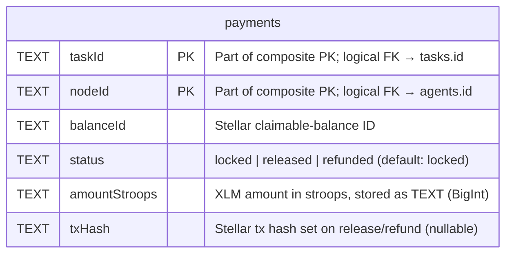
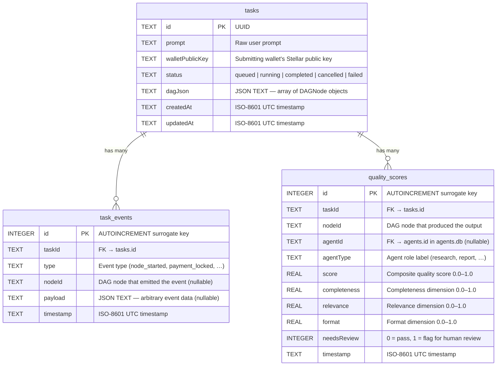

# Database Schema Reference

The backend uses three independent SQLite databases, each schema-versioned
with its own numbered migration files under
`backend/src/db/migrations/<db>/`. Migrations run automatically on first
connection via `migrateToLatest()`.

| Database file | Purpose | Migration directory |
|---|---|---|
| `payments.db` | Stellar claimable-balance payment records | `migrations/payments/` |
| `agents.db` | Agent registry — capabilities, pricing, reputation | `migrations/agents/` |
| `tasks.db` | Tasks, DAG execution events, and quality scores | `migrations/tasks/` |

> **Logical foreign keys** — SQLite does not enforce cross-table or
> cross-database foreign keys. The relationships shown in the diagrams below
> are enforced at the application layer.

---

## payments.db

Tracks the lifecycle of every Stellar claimable-balance payment issued by the
coordinator on behalf of a task node. Each row represents one escrow operation
between a task and the agent node that was hired to execute it.

### ER Diagram



> `amountStroops` is serialised as a decimal string so that JavaScript
> `BigInt` precision is preserved across the SQLite TEXT column boundary.
> At read time it is cast back to `BigInt` by `createPaymentDb`.

### Indexes

| Index name | Column(s) | Purpose |
|---|---|---|
| `PRIMARY KEY (taskId, nodeId)` | `taskId`, `nodeId` | Composite primary key; enforces one payment record per task+node pair |
| `idx_payments_status` | `status` | Accelerates reconciliation queries that filter by payment status (e.g. finding all `locked` payments) |

### Column Notes

| Column | Type | Constraint | Notes |
|---|---|---|---|
| `taskId` | TEXT | NOT NULL, PK | References `tasks.id` in `tasks.db` |
| `nodeId` | TEXT | NOT NULL, PK | References `agents.id` in `agents.db` |
| `balanceId` | TEXT | NOT NULL | Deterministic Stellar claimable-balance ID derived before signing |
| `status` | TEXT | NOT NULL, DEFAULT `'locked'` | Allowed values: `locked`, `released`, `refunded` |
| `amountStroops` | TEXT | NOT NULL | BigInt serialised as decimal string |
| `txHash` | TEXT | nullable | Set to the Stellar transaction hash after `release` or `refund` |

---

## agents.db

Stores agent registrations — every agent that has announced itself to the
network. Acts as a local cache of the on-chain registry, augmented with
runtime reputation and availability bookkeeping.

### ER Diagram

```mermaid
erDiagram
    agents {
        TEXT    id               PK  "UUID"
        TEXT    capabilities     "JSON TEXT array, e.g. [\"research\",\"report\"]"
        REAL    pricingXLM       "Per-task price in XLM"
        TEXT    endpoint         "HTTP URL the agent listens on"
        TEXT    stellarPublicKey "Agent Stellar account (G...)"
        REAL    reputationScore  "0.0–5.0 float, default 2.5"
        TEXT    lastSeenAt       "ISO-8601 UTC timestamp of last heartbeat"
        TEXT    status           "online | offline  (default: offline)"
        REAL    bondAmountXLM    "Staked bond in XLM (default 0)"
        INTEGER tasksCompleted   "Successful task count (default 0)"
        INTEGER tasksFailed      "Failed task count (default 0)"
        TEXT    lastActiveAt     "ISO-8601 UTC timestamp of last task activity (nullable)"
    }
```

> **Runtime columns** — `bondAmountXLM`, `tasksCompleted`, `tasksFailed`, and
> `lastActiveAt` are not in the numbered migration file. They are added via
> `ALTER TABLE … ADD COLUMN` inside `ensureAgentTable()` (see
> `backend/src/db/agents.ts`) with idempotent error suppression, so they are
> safe to apply to existing databases.

### Indexes

| Index name | Column(s) | Purpose |
|---|---|---|
| `PRIMARY KEY (id)` | `id` | Unique agent lookup by ID |
| _(implicit SQLite rowid)_ | `rowid` | Physical row ordering; used by keyset cursor pagination `(lastSeenAt DESC, id DESC)` |

### Column Notes

| Column | Type | Constraint | Notes |
|---|---|---|---|
| `id` | TEXT | PRIMARY KEY | Universally unique agent identifier |
| `capabilities` | TEXT | NOT NULL | JSON array of capability strings; queried with `json_each()` |
| `pricingXLM` | REAL | NOT NULL | Task price advertised to the coordinator |
| `endpoint` | TEXT | NOT NULL | Base URL for the agent's HTTP API |
| `stellarPublicKey` | TEXT | NOT NULL | Used for payment claimant assignment |
| `reputationScore` | REAL | NOT NULL, DEFAULT `2.5` | Clamped to `[0.0, 5.0]` on every write |
| `lastSeenAt` | TEXT | NOT NULL | Updated on each heartbeat; drives stale-agent detection |
| `status` | TEXT | NOT NULL, DEFAULT `'offline'` | `online` / `offline` |
| `bondAmountXLM` | REAL | NOT NULL, DEFAULT `0` | Collateral staked by the agent |
| `tasksCompleted` | INTEGER | NOT NULL, DEFAULT `0` | Incremented on successful task outcome |
| `tasksFailed` | INTEGER | NOT NULL, DEFAULT `0` | Incremented on failed task outcome |
| `lastActiveAt` | TEXT | nullable | Updated alongside reputation on task completion |

---

## tasks.db

Contains three related tables that together represent the full lifecycle of a
user task: the task record itself, an append-only event log, and per-node
quality evaluations.

### ER Diagram



### Indexes

| Index name | Column(s) | Table | Purpose |
|---|---|---|---|
| `PRIMARY KEY (id)` | `id` | `tasks` | Unique task lookup |
| `idx_tasks_created_at` | `createdAt` | `tasks` | Accelerates `ORDER BY createdAt` and `createdAfter` range queries |
| `PRIMARY KEY (id)` | `id` | `task_events` | Unique event row; also used for ordered event replay (`ORDER BY id ASC`) |
| `idx_task_events_taskId` | `taskId` | `task_events` | Fast event history lookup by task (`getEventHistory`) |
| `PRIMARY KEY (id)` | `id` | `quality_scores` | Unique score row |
| `idx_quality_scores_agentId` | `agentId` | `quality_scores` | Accelerates per-agent quality queries (`listQualityScores(agentId)`) |

### Column Notes — `tasks`

| Column | Type | Constraint | Notes |
|---|---|---|---|
| `id` | TEXT | PRIMARY KEY | UUID |
| `prompt` | TEXT | NOT NULL | Original user-submitted prompt |
| `walletPublicKey` | TEXT | NOT NULL, DEFAULT `''` | Scopes task list queries per wallet |
| `status` | TEXT | NOT NULL, DEFAULT `'queued'` | Allowed: `queued`, `running`, `completed`, `cancelled`, `failed` |
| `dagJson` | TEXT | NOT NULL, DEFAULT `'[]'` | Serialised `DAGNode[]`; updated as nodes execute |
| `createdAt` | TEXT | NOT NULL | Set at insert; indexed for range/sort queries |
| `updatedAt` | TEXT | NOT NULL | Updated on every status or DAG change |

### Column Notes — `task_events`

| Column | Type | Constraint | Notes |
|---|---|---|---|
| `id` | INTEGER | PRIMARY KEY AUTOINCREMENT | Monotonically increasing; used as event cursor |
| `taskId` | TEXT | NOT NULL | Logical FK → `tasks.id` |
| `type` | TEXT | NOT NULL | One of the `DAGEventType` values (e.g. `node_started`, `payment_released`) |
| `nodeId` | TEXT | nullable | Present for node-scoped events |
| `payload` | TEXT | nullable | JSON-serialised event metadata |
| `timestamp` | TEXT | NOT NULL | ISO-8601 UTC timestamp |

### Column Notes — `quality_scores`

| Column | Type | Constraint | Notes |
|---|---|---|---|
| `id` | INTEGER | PRIMARY KEY AUTOINCREMENT | Surrogate row key |
| `taskId` | TEXT | NOT NULL | Logical FK → `tasks.id` |
| `nodeId` | TEXT | NOT NULL | DAG node whose output was evaluated |
| `agentId` | TEXT | nullable | Logical FK → `agents.id` (absent for coordinator-generated scores) |
| `agentType` | TEXT | NOT NULL | Role label such as `research`, `report`, `coding` |
| `score` | REAL | NOT NULL | Weighted composite of the three sub-dimensions |
| `completeness` | REAL | NOT NULL | 0.0–1.0 |
| `relevance` | REAL | NOT NULL | 0.0–1.0 |
| `format` | REAL | NOT NULL | 0.0–1.0 |
| `needsReview` | INTEGER | NOT NULL, DEFAULT `0` | SQLite boolean: `0` = pass, `1` = flag for human review |
| `timestamp` | TEXT | NOT NULL | ISO-8601 UTC timestamp of the scoring run |

---

## Cross-Database Relationships

SQLite cannot enforce foreign keys across database files. The following
logical relationships are maintained exclusively at the application layer:

```
tasks.db: tasks.id
    ← task_events.taskId         (same DB)
    ← quality_scores.taskId      (same DB)
    ← payments.taskId            (cross-DB: payments.db)

agents.db: agents.id
    ← quality_scores.agentId     (cross-DB: tasks.db)
    ← payments.nodeId            (cross-DB: payments.db)
```

---

## Migration History

### payments.db

| Version | File | Change |
|---|---|---|
| 001 | `001_create_payments_table.up.sql` | Created the `payments` table with composite `PRIMARY KEY (taskId, nodeId)`, columns for `balanceId`, `status` (default `locked`), `amountStroops`, and nullable `txHash`. |
| 002 | `002_add_status_index.up.sql` | Added `idx_payments_status` on `payments(status)` to speed up reconciliation queries that scan for `locked` records. |

### agents.db

| Version | File | Change |
|---|---|---|
| 001 | `001_create_agents_table.up.sql` | Created the `agents` table with `id TEXT PRIMARY KEY`, `capabilities`, `pricingXLM`, `endpoint`, `stellarPublicKey`, `reputationScore` (default `0`), `lastSeenAt`, and `status` (default `offline`). |
| —   | _(runtime, `ensureAgentTable`)_ | Applied via `ALTER TABLE … ADD COLUMN` at startup (not a numbered migration): added `bondAmountXLM REAL DEFAULT 0`, `tasksCompleted INTEGER DEFAULT 0`, `tasksFailed INTEGER DEFAULT 0`, `lastActiveAt TEXT`. These columns are idempotently added and will no-op if already present. |

### tasks.db

| Version | File | Change |
|---|---|---|
| 001 | `001_create_tasks_table.up.sql` | Created the `tasks` table with `id TEXT PRIMARY KEY`, `prompt`, `walletPublicKey` (default `''`), `status` (default `queued`), `dagJson` (default `'[]'`), `createdAt`, and `updatedAt`. |
| 002 | `002_create_task_events_table.up.sql` | Created the `task_events` table with `id INTEGER PRIMARY KEY AUTOINCREMENT`, `taskId`, `type`, nullable `nodeId` and `payload`, and `timestamp`. Added `idx_task_events_taskId` on `task_events(taskId)`. |
| 003 | `003_create_quality_scores_table.up.sql` | Created the `quality_scores` table with `id INTEGER PRIMARY KEY AUTOINCREMENT`, `taskId`, `nodeId`, nullable `agentId`, `agentType`, `score`, `completeness`, `relevance`, `format`, `needsReview` (default `0`), and `timestamp`. Added `idx_quality_scores_agentId` on `quality_scores(agentId)`. |
| 004 | `004_add_created_at_index.up.sql` | Added `idx_tasks_created_at` on `tasks("createdAt")` to accelerate `ORDER BY createdAt` pagination and `createdAfter` range filters on the task list API. |

---

## Running Migrations

Migrations run automatically on server start. To run or roll back manually:

```bash
cd backend
npm run db:migrate          # apply all pending migrations for all three databases
npm run db:rollback         # roll back the most recent migration (--steps N for more)
npm run db:seed             # migrate, then insert local-dev sample data
```

Migration files follow the naming convention
`<NNN>_<description>.<up|down>.sql`. The migrator tracks applied versions in a
`schema_migrations` table within each database file.
