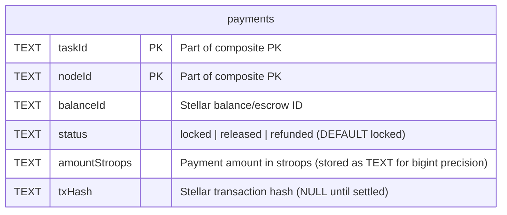
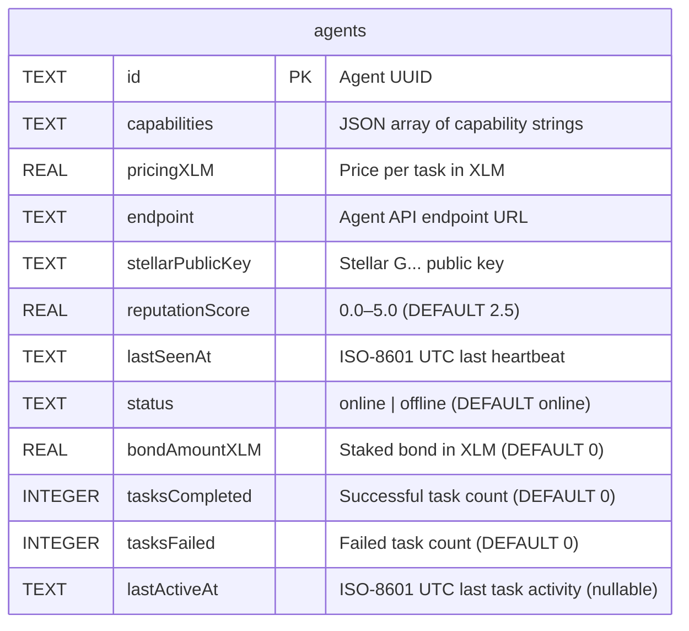
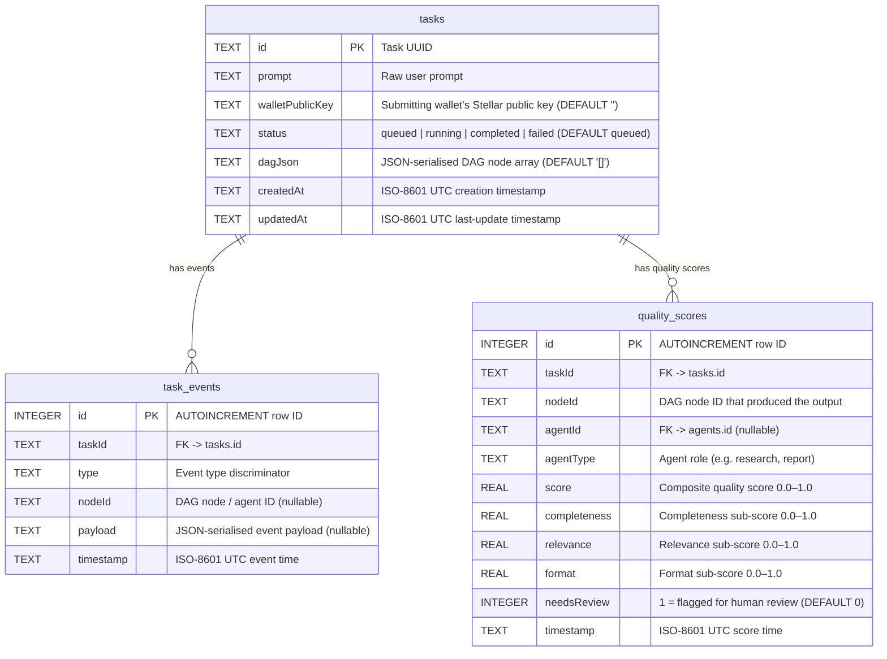
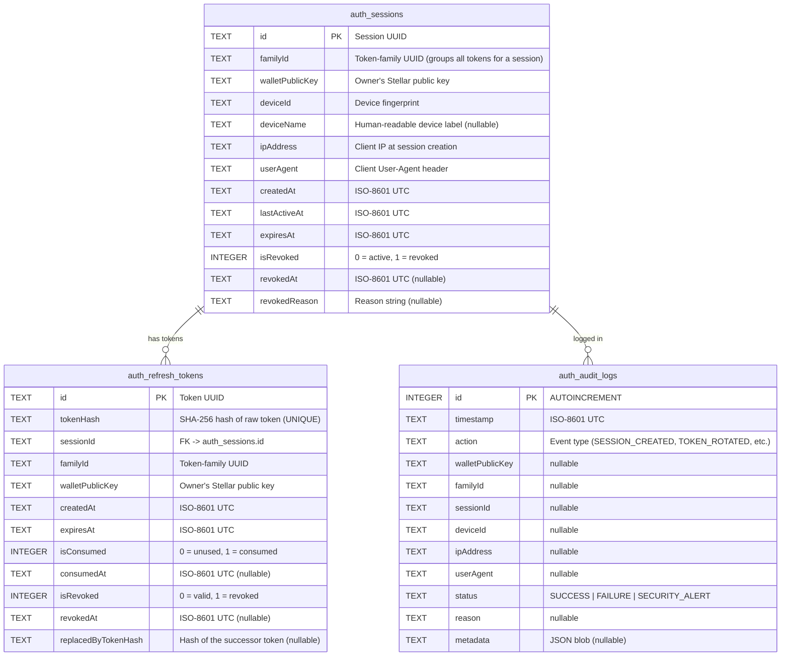
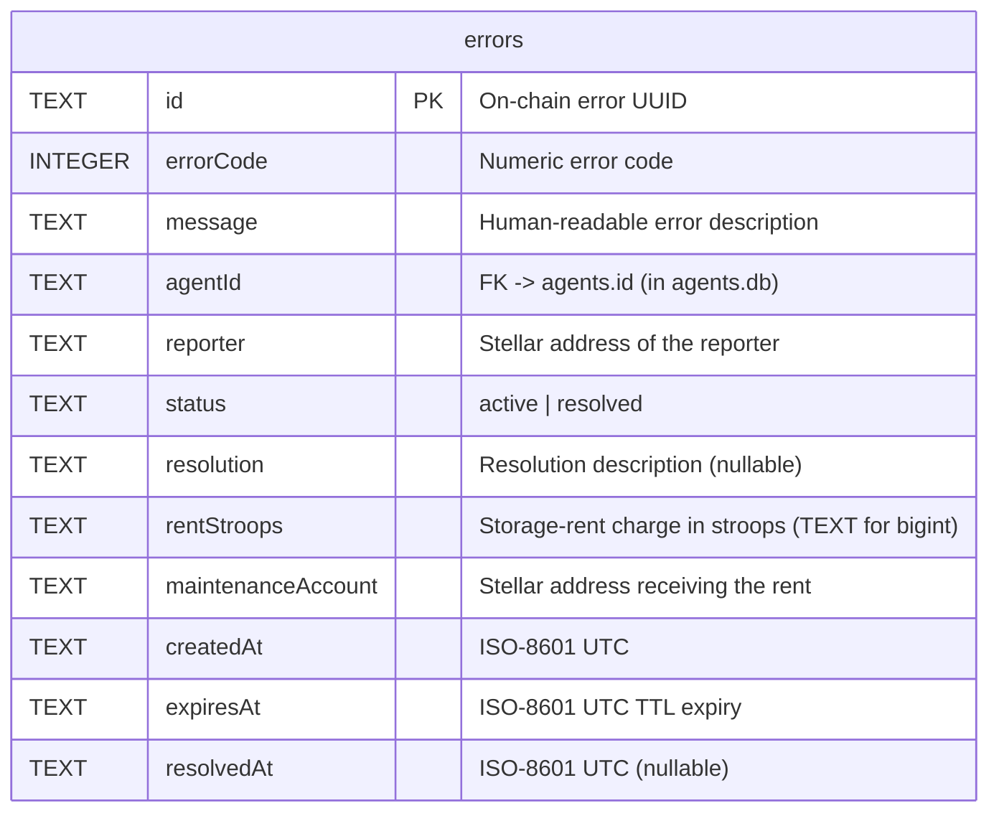
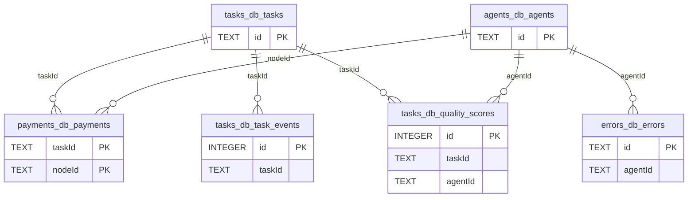

# Database Schema Reference

The backend uses five SQLite databases, each scoped to a single concern. This document covers every table, its columns, the indexes that serve common queries, and the full migration history.

Three databases (`payments.db`, `agents.db`, `tasks.db`) are schema-versioned through the file-based migrator in `backend/src/db/migrator.ts`. Two databases (`auth.db`, `errors.db`) manage their schemas inline at startup.

---

## Contents

1. [payments.db](#paymentsdb)
2. [agents.db](#agentsdb)
3. [tasks.db](#tasksdb)
4. [auth.db](#authdb)
5. [errors.db](#errorsdb)
6. [Cross-Database Relationships](#cross-database-relationships)
7. [Known Issues](#known-issues)

---

## payments.db

Tracks the lifecycle of every agent payment — from initial lock through Stellar settlement to final release or refund.

### ER Diagram



> **Relationships:** `taskId` logically references `tasks.id` in `tasks.db`; `nodeId` logically references `agents.id` in `agents.db`. SQLite does not enforce cross-file foreign keys.

### Table: `payments`

Stores one row per `(task, agent)` payment pair. The composite primary key `(taskId, nodeId)` ensures each agent is paid exactly once per task.

| Column | Type | Constraints | Description |
|---|---|---|---|
| `taskId` | TEXT | NOT NULL, PK | ID of the task being paid for |
| `nodeId` | TEXT | NOT NULL, PK | ID of the agent receiving payment |
| `balanceId` | TEXT | NOT NULL | Stellar claimable-balance or escrow ID |
| `status` | TEXT | NOT NULL, DEFAULT `'locked'` | Payment lifecycle state: `locked`, `released`, `refunded` |
| `amountStroops` | TEXT | NOT NULL | Payment amount in Stellar stroops, stored as TEXT to preserve bigint precision |
| `txHash` | TEXT | nullable | Stellar transaction hash; NULL until payment is settled on-chain |

### Indexes

| Index | Columns | Purpose |
|---|---|---|
| `PRIMARY KEY` | `(taskId, nodeId)` | Idempotent inserts; fast lookup by payment key |
| `idx_payments_status` | `status` | Payment reconciliation queries filtered by status (e.g. fetch all `locked` payments) |

### Migration History

| Version | File | Change |
|---|---|---|
| 001 | `001_create_payments_table.up.sql` | Create `payments` table with composite PK `(taskId, nodeId)` |
| 002 | `002_add_status_index.up.sql` | Add `idx_payments_status` index on `status` to accelerate reconciliation scans |

---

## agents.db

Registry of all known agents — their capabilities, pricing, Stellar identity, reputation, and heartbeat state.

### ER Diagram



### Table: `agents`

One row per registered agent. The `capabilities` column holds a JSON array (e.g. `["research", "summarise"]`) queried with SQLite's `json_each()`.

| Column | Type | Constraints | Description |
|---|---|---|---|
| `id` | TEXT | NOT NULL, PK | Unique agent identifier (UUID) |
| `capabilities` | TEXT | NOT NULL | JSON array of capability strings |
| `pricingXLM` | REAL | NOT NULL | Price per task, in XLM |
| `endpoint` | TEXT | NOT NULL | Agent API base URL |
| `stellarPublicKey` | TEXT | NOT NULL | Agent's Stellar public key (G...) |
| `reputationScore` | REAL | NOT NULL, DEFAULT `2.5` | Reputation on a 0.0–5.0 scale; clamped on every write |
| `lastSeenAt` | TEXT | NOT NULL | ISO-8601 UTC timestamp of last heartbeat |
| `status` | TEXT | NOT NULL, DEFAULT `'online'` | `online` or `offline`; driven by heartbeat and stale-agent sweep |
| `bondAmountXLM` | REAL | NOT NULL, DEFAULT `0` | XLM bonded as collateral |
| `tasksCompleted` | INTEGER | NOT NULL, DEFAULT `0` | Cumulative count of successfully completed tasks |
| `tasksFailed` | INTEGER | NOT NULL, DEFAULT `0` | Cumulative count of failed tasks |
| `lastActiveAt` | TEXT | nullable | ISO-8601 UTC timestamp of last task activity |

### Indexes

| Index | Columns | Purpose |
|---|---|---|
| `PRIMARY KEY` | `id` | Fast agent lookup by ID |

> **Note:** The `listCursor` query in `agents.ts` uses a compound keyset `(lastSeenAt DESC, id DESC)` for stable cursor-based pagination. Adding a covering index on `(lastSeenAt DESC, id DESC)` would benefit high-traffic agent listings.

### Migration History

| Version | File | Change |
|---|---|---|
| 001 | `001_create_agents_table.up.sql` | Create `agents` table with core columns: `id`, `capabilities`, `pricingXLM`, `endpoint`, `stellarPublicKey`, `reputationScore` (DEFAULT `0`), `lastSeenAt`, `status` (DEFAULT `'offline'`) |

> **Note on inline migrations:** `agents.ts` (`ensureAgentTable`) applies additional `ALTER TABLE` statements at startup — outside the formal migration runner — to add `status`, `bondAmountXLM`, `tasksCompleted`, `tasksFailed`, and `lastActiveAt`. These columns are now included in the `CREATE TABLE` used by fresh installs, so the `ALTER TABLE` statements are no-ops for new databases and backward-compatibility shims for databases created before those columns existed.
>
> The `reputationScore` DEFAULT was also changed from `0` (migration 001) to `2.5` (current `CREATE TABLE` in `ensureAgentTable`). Existing rows keep their stored value; only new inserts receive `2.5`.

---

## tasks.db

Stores user-submitted tasks, their DAG execution plans, per-task event history, and agent quality scores.

### ER Diagram



### Table: `tasks`

One row per user task. `dagJson` holds the serialised execution graph — an array of DAG node objects that the coordinator populates as it decomposes and routes the task.

| Column | Type | Constraints | Description |
|---|---|---|---|
| `id` | TEXT | NOT NULL, PK | Task UUID |
| `prompt` | TEXT | NOT NULL | Raw user-submitted prompt |
| `walletPublicKey` | TEXT | NOT NULL, DEFAULT `''` | Stellar public key of the submitting wallet |
| `status` | TEXT | NOT NULL, DEFAULT `'queued'` | Task lifecycle state: `queued`, `running`, `completed`, `failed` |
| `dagJson` | TEXT | NOT NULL, DEFAULT `'[]'` | JSON array of DAG node objects |
| `createdAt` | TEXT | NOT NULL | ISO-8601 UTC creation timestamp |
| `updatedAt` | TEXT | NOT NULL | ISO-8601 UTC last-update timestamp |

### Table: `task_events`

Append-only event log for a task. Each row is one event emitted during execution (e.g. `task_started`, `node_completed`, `payment_locked`). Rows are never updated or deleted.

| Column | Type | Constraints | Description |
|---|---|---|---|
| `id` | INTEGER | NOT NULL, PK AUTOINCREMENT | Monotonic row ID; used to replay events in insertion order |
| `taskId` | TEXT | NOT NULL | References `tasks.id` |
| `type` | TEXT | NOT NULL | Event type string (e.g. `node_started`, `payment_released`) |
| `nodeId` | TEXT | nullable | DAG node or agent ID the event relates to |
| `payload` | TEXT | nullable | JSON-serialised event-specific data |
| `timestamp` | TEXT | NOT NULL | ISO-8601 UTC time the event was emitted |

### Table: `quality_scores`

Stores automated quality evaluations produced by the `QualityScorer` service after each agent response. Scores drive reputation updates in `agents.db`.

| Column | Type | Constraints | Description |
|---|---|---|---|
| `id` | INTEGER | NOT NULL, PK AUTOINCREMENT | Row ID |
| `taskId` | TEXT | NOT NULL | References `tasks.id` |
| `nodeId` | TEXT | NOT NULL | DAG node ID whose output was scored |
| `agentId` | TEXT | nullable | References `agents.id`; NULL if the agent is unknown |
| `agentType` | TEXT | NOT NULL | Agent role (e.g. `research`, `risk`, `report`) |
| `score` | REAL | NOT NULL | Overall quality score (0.0–1.0) |
| `completeness` | REAL | NOT NULL | Completeness sub-score (0.0–1.0) |
| `relevance` | REAL | NOT NULL | Relevance sub-score (0.0–1.0) |
| `format` | REAL | NOT NULL | Format/structure sub-score (0.0–1.0) |
| `needsReview` | INTEGER | NOT NULL, DEFAULT `0` | `1` if the scorer flagged the response for human review |
| `timestamp` | TEXT | NOT NULL | ISO-8601 UTC score timestamp |

### Indexes

| Index | Table | Columns | Purpose |
|---|---|---|---|
| `PRIMARY KEY` | `tasks` | `id` | Fast task lookup by ID |
| `idx_tasks_created_at` | `tasks` | `createdAt` | Time-range list queries and stats aggregations |
| `idx_task_events_taskId` | `task_events` | `taskId` | Fetch full event history for a task (`getEventHistory`) |
| `idx_quality_scores_agentId` | `quality_scores` | `agentId` | List all quality scores for an agent (`listQualityScores(agentId)`) |

### Migration History

| Version | File | Change |
|---|---|---|
| 001 | `001_create_tasks_table.up.sql` | Create `tasks` table |
| 002 | `002_create_task_events_table.up.sql` | Create `task_events` table with `idx_task_events_taskId` |
| 003 | `003_create_quality_scores_table.up.sql` | Create `quality_scores` table with `idx_quality_scores_agentId` |
| 004 | `004_add_created_at_index.up.sql` | Add `idx_tasks_created_at` on `tasks.createdAt` |

---

## auth.db

Manages wallet-authenticated sessions, refresh-token rotation, and a tamper-evident audit trail. Schema is created inline at startup — there are no migration files.

### ER Diagram



### Table: `auth_sessions`

One row per active or revoked session. Sessions are identified by a `familyId` that groups all refresh tokens belonging to the same login event, enabling whole-family revocation on token-reuse detection.

### Table: `auth_refresh_tokens`

Implements sliding-window token rotation. Each consumed token records its successor via `replacedByTokenHash`, forming a chain. A reuse of a consumed token triggers whole-family revocation.

### Table: `auth_audit_logs`

Append-only log of every auth event. Used for security investigations and anomaly detection. Rows are never deleted.

### Indexes

| Index | Table | Columns | Purpose |
|---|---|---|---|
| `PRIMARY KEY` | `auth_sessions` | `id` | Session lookup |
| `idx_auth_sessions_familyId` | `auth_sessions` | `familyId` | Whole-family revocation |
| `idx_auth_sessions_wallet` | `auth_sessions` | `walletPublicKey` | List all sessions for a wallet |
| `idx_auth_sessions_device` | `auth_sessions` | `(walletPublicKey, deviceId)` | Per-device session lookup |
| `PRIMARY KEY` | `auth_refresh_tokens` | `id` | Token lookup by ID |
| `idx_auth_tokens_hash` | `auth_refresh_tokens` | `tokenHash` | Token validation (hash lookup) |
| `idx_auth_tokens_familyId` | `auth_refresh_tokens` | `familyId` | Family revocation |
| `idx_auth_tokens_sessionId` | `auth_refresh_tokens` | `sessionId` | Token revocation on session revoke |
| `idx_auth_audit_wallet` | `auth_audit_logs` | `walletPublicKey` | Audit trail per wallet |
| `idx_auth_audit_familyId` | `auth_audit_logs` | `familyId` | Audit trail per session family |
| `idx_auth_audit_action` | `auth_audit_logs` | `action` | Filter by event type |
| `idx_auth_audit_timestamp` | `auth_audit_logs` | `timestamp` | Time-range audit queries |

### Migration History

`auth.db` has no formal migration files. The full schema is created by `getAuthDb()` in `backend/src/db/auth.ts` using `CREATE TABLE IF NOT EXISTS` and `CREATE INDEX IF NOT EXISTS`. Any future structural changes must either be added as inline `ALTER TABLE` statements (with `try/catch` for idempotency) or migrated to the file-based migrator.

---

## errors.db

Tracks on-chain error reports filed against agents, including TTL-based expiry and per-entry storage-rent accounting. Schema is created inline at startup — there are no migration files.

### ER Diagram



> **Relationship:** `agentId` logically references `agents.id` in `agents.db`.

### Table: `errors`

Mirrors the on-chain error lifecycle (`err_rptd` / `err_rslvd`) locally. Rows are soft-expired by TTL: `sweepExpired()` deletes rows whose `expiresAt` has passed. Read queries always filter on `expiresAt > now` so stale rows are never visible between sweeps. A per-agent live-entry cap prevents a single faulty agent from saturating the registry.

### Indexes

| Index | Columns | Purpose |
|---|---|---|
| `PRIMARY KEY` | `id` | Error lookup by ID |
| `idx_errors_agent` | `(agentId, status)` | List live errors per agent; enforce per-agent cap |
| `idx_errors_expiry` | `expiresAt` | Efficient TTL sweep (`sweepExpired`) |

### Migration History

`errors.db` has no formal migration files. The schema is created by `getErrorDb()` in `backend/src/db/errorRegistry.ts` using `CREATE TABLE IF NOT EXISTS`.

---

## Cross-Database Relationships

SQLite does not support foreign keys that span separate database files. The relationships below are logical conventions enforced in application code.



| Child column | References | Enforcement |
|---|---|---|
| `payments.taskId` | `tasks.id` | Application layer |
| `payments.nodeId` | `agents.id` | Application layer |
| `task_events.taskId` | `tasks.id` | Application layer |
| `quality_scores.taskId` | `tasks.id` | Application layer |
| `quality_scores.agentId` | `agents.id` | Application layer (nullable) |
| `errors.agentId` | `agents.id` | Application layer |
| `auth_refresh_tokens.sessionId` | `auth_sessions.id` | Application layer |

---

## Known Issues

### `stats.ts` — mismatched column names in payments queries

`backend/src/db/stats.ts` queries the `payments` table using column names that do not exist in the current schema:

```sql
-- stats.ts line ~50 (getTotalXLMTransacted)
SELECT COALESCE(SUM(amount), 0) AS amount FROM payments WHERE status = 'released'
--                   ^^^^^^ does not exist — actual column is amountStroops

-- stats.ts line ~72 (getXLMHourlyTotals)
SELECT strftime(..., "createdAt") AS hour, ... FROM payments WHERE ...
--                    ^^^^^^^^^^ does not exist — payments has no createdAt column
```

The actual column is `amountStroops` (TEXT, bigint-as-string). The `payments` table has no `createdAt` column. These queries will return `0` / empty results at runtime rather than raising an error, because `SUM(NULL)` coalesces to 0 and the WHERE clause on a missing column matches no rows.

**Impact:** The `/api/stats` endpoint reports `totalXLMTransacted = 0` and flat XLM time-series even when payments exist. **Resolution:** Add a `createdAt` column to `payments` in a new migration (v003), and fix the `amount` → `amountStroops` column reference in `stats.ts` with appropriate CAST to REAL.

### `events.sql` — alternate schema not wired up

`backend/src/db/events.sql` defines a richer `task_events` schema (with `global_seq`, `task_seq`, `version`, `occurred_at` instead of `timestamp`) intended for append-only event sourcing. This DDL is **not applied** by any migration or startup code; the active schema is the one created by `tasks` migration 002. The `.sql` file appears to be a planned future replacement.
