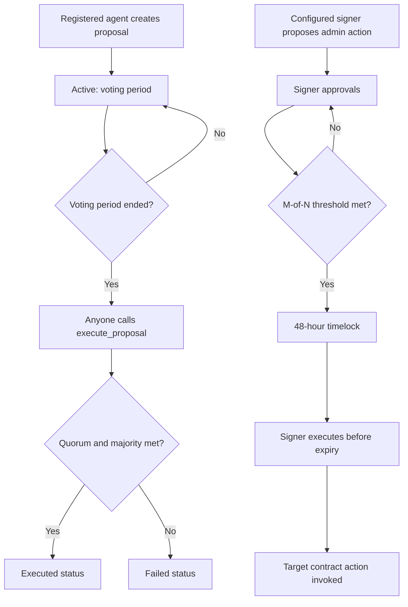

# Governance Voting Guide

This guide describes the on-chain governance contracts in `smart-contracts`.
The repository does not currently expose a governance REST API or a governance
screen in the frontend. Reads and transactions are made through the Stellar
Soroban RPC for the deployed contract IDs.

## Governance Models

The network has two distinct mechanisms:

| Mechanism | Participants | Purpose |
| --- | --- | --- |
| Agent governance (`agent_governance`) | Registered agent stakeholders with positive voting power | Time-limited proposals about parameters, agent disputes, or protocol upgrades. |
| Multisig governance (`multisig_governance`) | The contract's configured signers | Sensitive administrative actions, including contract upgrades, configuration updates, bond slashing, and signer rotation. |

Agent governance is not a token-holder ballot: the contract records an agent's
stake and reputation when registered. In the current implementation,
`register_agent` accepts a stake value but does not transfer or lock tokens.
Do not treat this record as proof of an independently escrowed token balance.

## Proposal Lifecycle



Agent proposal status `Executed` means the contract finalized the vote as
passing. The current agent-governance contract does not itself execute the
described parameter change or protocol upgrade; any resulting operational
change must be carried out by the responsible authorized process. The multisig
contract does invoke its configured target action when its proposal executes.

## Eligibility and Voting Power

An agent must be registered in the governance contract to propose or vote.
Each registered agent can vote once on each active proposal. Its power is:

`voting power = stake in stroops + reputation x 1,000,000`

One reputation point contributes 0.1 XLM of voting weight. The reputation score
must be between 0 and 100, and the resulting voting power must be greater than
zero. Voting power is read when the vote is cast; the proposal's total-power
denominator is snapshotted when the proposal is created.

The electorate rules are:

- **Quorum:** `For + Against + Abstain` must reach at least 30% of the total
  voting power snapshot.
- **Majority:** `For` must be strictly greater than 50% of `For + Against`.
  Abstentions count toward quorum, but not toward decisive votes.
- **Voting period:** defaults to seven days; a custom period must be between
  one hour and 30 days.

## Browse Proposals

There is no governance endpoint in the backend API or proposal browser in the
frontend today. Use the governance contract's `get_proposal_count` and
`get_proposal` read methods, and subscribe to the contract's emitted events.
Proposal IDs start at 1. Iterate IDs from 1 through the current count and keep
records with `status = Active` whose `voting_ends_at` is in the future.

Set the testnet endpoint and deployed contract IDs for your environment:

```bash
export STELLAR_RPC_URL="https://soroban-testnet.stellar.org"
export AGENT_GOVERNANCE_CONTRACT_ID="<deployed-contract-id>"
export MULTISIG_GOVERNANCE_CONTRACT_ID="<deployed-contract-id>"
```

Soroban contract calls are carried in XDR transaction envelopes. Build the
envelope for the listed contract method and arguments with the Stellar SDK or
CLI, then use these JSON-RPC calls. Read-only calls are simulated; state changes
must be simulated, authorized and signed by the required address, and then
submitted. `SIMULATION_XDR` and `SIGNED_TRANSACTION_XDR` below are base64 XDR
values produced by that client flow, not JSON contract arguments.

### Read proposal records and events

Use a simulated envelope for `get_proposal_count`, `get_proposal`,
`get_total_voting_power`, `get_agent`, or `get_vote`:

```bash
curl --fail-with-body "$STELLAR_RPC_URL" \
  -H 'Content-Type: application/json' \
  -d '{"jsonrpc":"2.0","id":1,"method":"simulateTransaction","params":{"transaction":"'"$SIMULATION_XDR"'"}}'
```

Fetch emitted governance events by contract and ledger range:

```bash
curl --fail-with-body "$STELLAR_RPC_URL" \
  -H 'Content-Type: application/json' \
  -d '{"jsonrpc":"2.0","id":2,"method":"getEvents","params":{"startLedger":'"$START_LEDGER"',"filters":[{"type":"contract","contractIds":["'"$AGENT_GOVERNANCE_CONTRACT_ID"'"]}]}}'
```

Agent governance emits `created`, `vote_cast`, `executed`, and `failed` events.
The multisig emits proposed, approved, rejected, executed, and cancelled events.
Use the returned cursor/ledger information to continue paginating event results.

## Create a Proposal and Vote

Only an already registered agent can create a proposal or vote. Proposal types
are `ParameterChange`, `AgentDispute`, and `ProtocolUpgrade`; the proposal
contains a title and description, and a zero voting-period argument selects the
seven-day default. Use the contract methods `create_proposal` and
`vote_on_proposal` with the corresponding typed Soroban arguments.

The writable RPC flow is:

1. Build a transaction envelope for the specific contract method and arguments.
2. Simulate it with `simulateTransaction` and inspect the result and resource
   fee before requesting authorization.
3. Authorize and sign it with the proposer/voter wallet; never send private
   keys to an API or paste them into a shell command.
4. Submit the signed XDR:

```bash
curl --fail-with-body "$STELLAR_RPC_URL" \
  -H 'Content-Type: application/json' \
  -d '{"jsonrpc":"2.0","id":3,"method":"sendTransaction","params":{"transaction":"'"$SIGNED_TRANSACTION_XDR"'"}}'
```

5. Poll the returned transaction hash until the RPC reports `SUCCESS` or a
   terminal failure:

```bash
curl --fail-with-body "$STELLAR_RPC_URL" \
  -H 'Content-Type: application/json' \
  -d '{"jsonrpc":"2.0","id":4,"method":"getTransaction","params":{"hash":"'"$TRANSACTION_HASH"'"}}'
```

To vote, choose exactly one of `For`, `Against`, or `Abstain`. A transaction
failure does not count as a vote; confirm the transaction result and query
`get_vote` before retrying.

## Finalize and Track Outcomes

After `voting_ends_at`, anyone may call `execute_proposal(proposal_id)`. The
contract evaluates quorum and majority and changes the status to `Executed` or
`Failed`; it is not permission to perform an unrelated upgrade or configuration
change. Query `get_proposal` again and inspect the `executed` or `failed` event
to verify the result. Before the deadline, the status remains `Active`.

For the current multisig state, use `get_signers`, `get_threshold`,
`get_proposal_count`, and `get_proposal`. A multisig proposal's proposer is
counted as its first approval. Other configured signers use `approve` or
`reject`; the proposer may `cancel` before execution. Once the approval
threshold is met, execution is allowed after the 48-hour timelock and before
the proposal's seven-day expiry. The signer threshold and timelock are separate
from agent-governance quorum and voting periods.

## Multisig Emergency Actions

Emergency administrative actions use `multisig_governance`, not an agent vote.
The proposer must be a configured signer and must authorize the proposal. The
proposal action names the target contract and operation. A matching number of
configured signers must approve; then the 48-hour timelock must elapse. An
authorized signer submits `execute`, which invokes the target contract. The
original proposer can cancel before execution. A proposal expires seven days
after it becomes eligible for execution.

Never bypass the configured signer threshold or timelock in an incident. Use
the organization-approved multisig and testnet deployment records, verify the
target contract and action parameters with other signers, and record the
transaction hash and result.

## FAQ

### What is the minimum stake to vote?

The contract has no fixed minimum stake. An agent's computed voting power must
be greater than zero, so a registered agent with positive reputation can have
positive voting power even when its recorded stake is zero. A zero-reputation
agent needs positive recorded stake. This is the contract's recorded value,
not a token transfer or lock enforced by this contract.

### What happens if quorum is not reached?

After the voting deadline, `execute_proposal` marks the proposal `Failed` when
total cast power is below 30% of the snapshotted electorate. The contract emits
a failure event with `quorum_met = false`. The proposal cannot be reopened or
reused; a new proposal must be created.

### Do abstentions help a proposal pass?

They count toward the 30% quorum but are excluded from the `For` versus
`Against` majority calculation.

### Can a voter change their vote?

No. Each registered agent can cast exactly one vote per proposal.

### Who can vote on multisig proposals?

Only configured signers can propose, approve, reject, or execute. Agent voting
power does not grant multisig signer privileges.