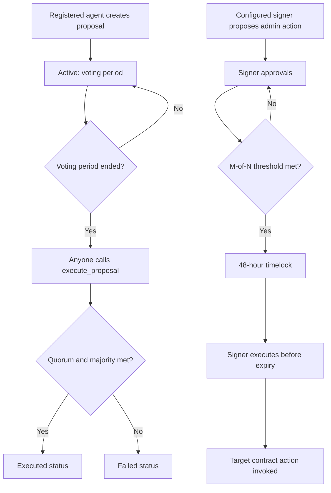
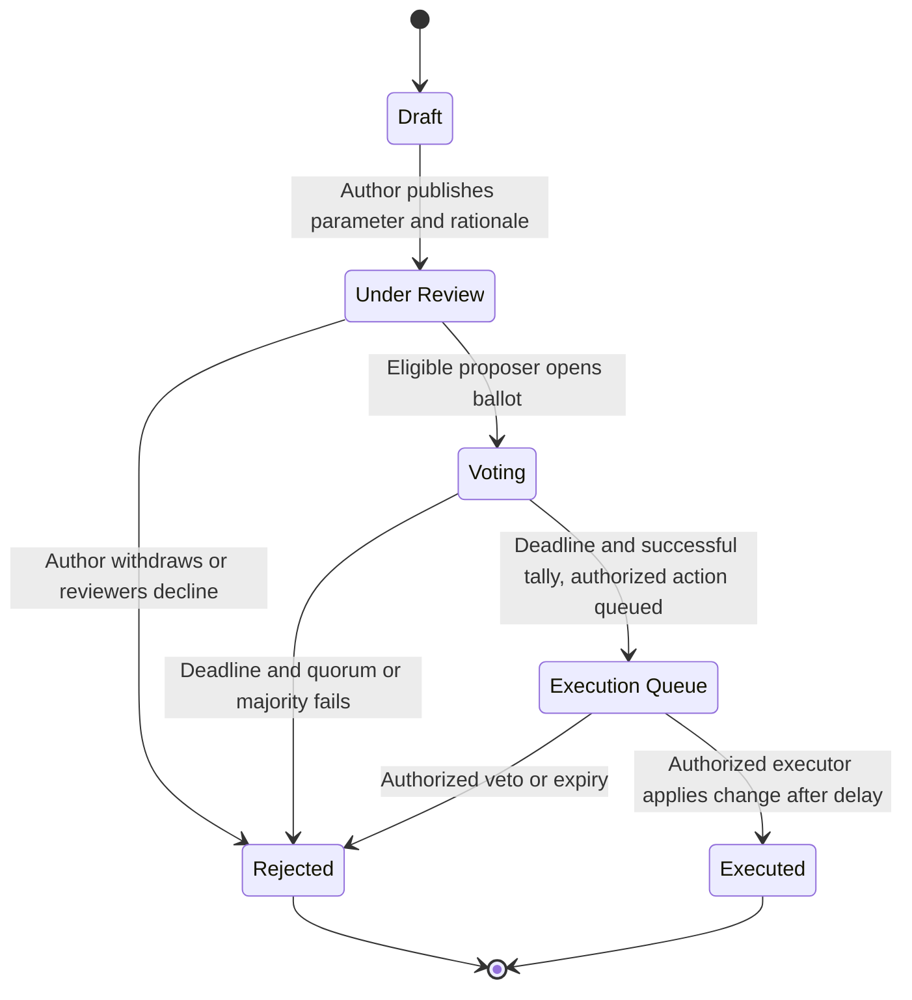

# Governance Voting Guide

This guide describes the on-chain governance contracts in `smart-contracts`.
The repository does not currently expose a governance REST API or a governance
screen in the frontend. Reads and transactions are made through the Stellar
Soroban RPC for the deployed contract IDs.

> Check the deployed quorum setting before voting. The 30% figures in the
> original examples below describe an earlier rule. The current source default
> is 10%, and the proposed parameter-governance policy uses 20%. The policy
> and the deployed contract behavior are described in detail below.

## Governance Models

The network has two distinct mechanisms:

| Mechanism | Participants | Purpose |
| --- | --- | --- |
| Agent governance (`agent_governance`) | Registered agent stakeholders with positive voting power | Time-limited proposals about parameters, agent disputes, or protocol upgrades. |
| Multisig governance (`multisig_governance`) | The contract's configured signers | Sensitive administrative actions, including contract upgrades, configuration updates, bond slashing, and signer rotation. |

Agent governance is not a token-holder ballot: the contract records an agent's
stake and reputation when registered. In the current implementation,
`register_agent` accepts a stake value but does not transfer or lock tokens.
Do not treat this record as proof of an independently escrowed token balance.

## Proposal Lifecycle



Agent proposal status `Executed` means the contract finalized the vote as
passing. The current agent-governance contract does not itself execute the
described parameter change or protocol upgrade; any resulting operational
change must be carried out by the responsible authorized process. The multisig
contract does invoke its configured target action when its proposal executes.

## Eligibility and Voting Power

An agent must be registered in the governance contract to propose or vote.
Each registered agent can vote once on each active proposal. Its power is:

`voting power = stake in stroops + reputation x 1,000,000`

One reputation point contributes 0.1 XLM of voting weight. The reputation score
must be between 0 and 100, and the resulting voting power must be greater than
zero. Voting power is read when the vote is cast; the proposal's total-power
denominator is snapshotted when the proposal is created.

The electorate rules are:

- **Quorum:** `For + Against + Abstain` must reach at least 30% of the total
  voting power snapshot.
- **Majority:** `For` must be strictly greater than 50% of `For + Against`.
  Abstentions count toward quorum, but not toward decisive votes.
- **Voting period:** defaults to seven days; a custom period must be between
  one hour and 30 days.

## Browse Proposals

There is no governance endpoint in the backend API or proposal browser in the
frontend today. Use the governance contract's `get_proposal_count` and
`get_proposal` read methods, and subscribe to the contract's emitted events.
Proposal IDs start at 1. Iterate IDs from 1 through the current count and keep
records with `status = Active` whose `voting_ends_at` is in the future.

Set the testnet endpoint and deployed contract IDs for your environment:

```bash
export STELLAR_RPC_URL="https://soroban-testnet.stellar.org"
export AGENT_GOVERNANCE_CONTRACT_ID="<deployed-contract-id>"
export MULTISIG_GOVERNANCE_CONTRACT_ID="<deployed-contract-id>"
```

Soroban contract calls are carried in XDR transaction envelopes. Build the
envelope for the listed contract method and arguments with the Stellar SDK or
CLI, then use these JSON-RPC calls. Read-only calls are simulated; state changes
must be simulated, authorized and signed by the required address, and then
submitted. `SIMULATION_XDR` and `SIGNED_TRANSACTION_XDR` below are base64 XDR
values produced by that client flow, not JSON contract arguments.

### Read proposal records and events

Use a simulated envelope for `get_proposal_count`, `get_proposal`,
`get_total_voting_power`, `get_agent`, or `get_vote`:

```bash
curl --fail-with-body "$STELLAR_RPC_URL" \
  -H 'Content-Type: application/json' \
  -d '{"jsonrpc":"2.0","id":1,"method":"simulateTransaction","params":{"transaction":"'"$SIMULATION_XDR"'"}}'
```

Fetch emitted governance events by contract and ledger range:

```bash
curl --fail-with-body "$STELLAR_RPC_URL" \
  -H 'Content-Type: application/json' \
  -d '{"jsonrpc":"2.0","id":2,"method":"getEvents","params":{"startLedger":'"$START_LEDGER"',"filters":[{"type":"contract","contractIds":["'"$AGENT_GOVERNANCE_CONTRACT_ID"'"]}]}}'
```

Agent governance emits `created`, `vote_cast`, `executed`, and `failed` events.
The multisig emits proposed, approved, rejected, executed, and cancelled events.
Use the returned cursor/ledger information to continue paginating event results.

## Create a Proposal and Vote

Only an already registered agent can create a proposal or vote. Proposal types
are `ParameterChange`, `AgentDispute`, and `ProtocolUpgrade`; the proposal
contains a title and description, and a zero voting-period argument selects the
seven-day default. Use the contract methods `create_proposal` and
`vote_on_proposal` with the corresponding typed Soroban arguments.

The writable RPC flow is:

1. Build a transaction envelope for the specific contract method and arguments.
2. Simulate it with `simulateTransaction` and inspect the result and resource
   fee before requesting authorization.
3. Authorize and sign it with the proposer/voter wallet; never send private
   keys to an API or paste them into a shell command.
4. Submit the signed XDR:

```bash
curl --fail-with-body "$STELLAR_RPC_URL" \
  -H 'Content-Type: application/json' \
  -d '{"jsonrpc":"2.0","id":3,"method":"sendTransaction","params":{"transaction":"'"$SIGNED_TRANSACTION_XDR"'"}}'
```

5. Poll the returned transaction hash until the RPC reports `SUCCESS` or a
   terminal failure:

```bash
curl --fail-with-body "$STELLAR_RPC_URL" \
  -H 'Content-Type: application/json' \
  -d '{"jsonrpc":"2.0","id":4,"method":"getTransaction","params":{"hash":"'"$TRANSACTION_HASH"'"}}'
```

To vote, choose exactly one of `For`, `Against`, or `Abstain`. A transaction
failure does not count as a vote; confirm the transaction result and query
`get_vote` before retrying.

## Finalize and Track Outcomes

After `voting_ends_at`, anyone may call `execute_proposal(proposal_id)`. The
contract evaluates quorum and majority and changes the status to `Executed` or
`Failed`; it is not permission to perform an unrelated upgrade or configuration
change. Query `get_proposal` again and inspect the `executed` or `failed` event
to verify the result. Before the deadline, the status remains `Active`.

For the current multisig state, use `get_signers`, `get_threshold`,
`get_proposal_count`, and `get_proposal`. A multisig proposal's proposer is
counted as its first approval. Other configured signers use `approve` or
`reject`; the proposer may `cancel` before execution. Once the approval
threshold is met, execution is allowed after the 48-hour timelock and before
the proposal's seven-day expiry. The signer threshold and timelock are separate
from agent-governance quorum and voting periods.

## Multisig Emergency Actions

Emergency administrative actions use `multisig_governance`, not an agent vote.
The proposer must be a configured signer and must authorize the proposal. The
proposal action names the target contract and operation. A matching number of
configured signers must approve; then the 48-hour timelock must elapse. An
authorized signer submits `execute`, which invokes the target contract. The
original proposer can cancel before execution. A proposal expires seven days
after it becomes eligible for execution.

Never bypass the configured signer threshold or timelock in an incident. Use
the organization-approved multisig and testnet deployment records, verify the
target contract and action parameters with other signers, and record the
transaction hash and result.

## FAQ

### What is the minimum stake to vote?

The contract has no fixed minimum stake. An agent's computed voting power must
be greater than zero, so a registered agent with positive reputation can have
positive voting power even when its recorded stake is zero. A zero-reputation
agent needs positive recorded stake. This is the contract's recorded value,
not a token transfer or lock enforced by this contract.

### What happens if quorum is not reached?

After the voting deadline, `execute_proposal` marks the proposal `Failed` when
total cast power is below 30% of the snapshotted electorate. The contract emits
a failure event with `quorum_met = false`. The proposal cannot be reopened or
reused; a new proposal must be created.

### Do abstentions help a proposal pass?

They count toward the 30% quorum but are excluded from the `For` versus
`Against` majority calculation.

### Can a voter change their vote?

No. Each registered agent can cast exactly one vote per proposal.

### Who can vote on multisig proposals?

Only configured signers can propose, approve, reject, or execute. Agent voting
power does not grant multisig signer privileges.
## Protocol parameter changes

The policy below describes the community lifecycle for parameter changes.
Settings are deployment-specific. The table uses repository defaults where
available and identifies the policy targets supplied for protocol governance.
A passing agent vote records an outcome. A separately authorized transaction
applies a parameter to the contract or service that owns it.

| Parameter | Current value or repository default | Minimum | Maximum | Change granularity and execution |
| --- | --- | --- | --- | --- |
| Platform fee | Policy reference 2%; `platform_config` ships with 0.5% | 0% | Policy 5%; contract accepts 100% | 1 basis point; an admin queues and applies the fee change |
| Minimum capability stake | 10 XLM in `capability_staking`; 1 XLM in the separate `platform_config` default | Recommend 0 | No policy maximum specified | 1 stroop; capability staking admin sets the override per capability |
| API request limits | Per minute: global 20, public 100, task 30, admin 20, registration 10, Venice proxy 10, heartbeat 60 | 1 for configurable limiters | No published policy maximum | 1 request per configured window; deployment configuration, with heartbeat's route limit defined in code |
| Oracle price freshness | Pair feed defaults to 3,600 seconds plus a 120-ledger cap; feeder aggregation window is five minutes | 1 second / 1 ledger | Unsigned 64-bit seconds / unsigned 32-bit ledgers | 1 second or ledger; price-oracle admin sets the corresponding cap |
| Oracle price deviation | 10% from the prior feeder median in the pair feed | Requires a contract change | Requires a contract change | Compile-time percentage |
| Reputation decay | 5% per week | Requires a contract change | Requires a contract change | Compile-time basis-point rate |
| Minimum heartbeat interval | No enforced minimum in the governance contracts; backend interval defaults to 30 seconds | 1 ms for the interval setting | No published policy maximum | 1 ms in backend configuration |
| Escrow timeout | 7 days | 1 day | Unsigned 32-bit days | 1 day in platform configuration |
| Maximum capabilities per agent | 10 | 1 | Unsigned 32-bit count | 1 capability in platform configuration |
| Agent proposal voting window | 7 days | 1 hour | 30 days | 1 second in the proposal; platform configuration also exposes a separate ledger-based setting |
| Quorum | Policy 20%; agent and platform configuration defaults are 10% | 0% | 100% for platform configuration | 1 basis point; read the threshold from agent governance for the ballot |
| Agent parameter queue delay | 48 ledgers by default | No validation minimum on the configuration setter | Unsigned 32-bit ledgers, limited in practice by change-entry expiry | 1 ledger; agent-governance admin configures the delay |
| Governance signer or guardian approvals | Deployment-specific; policy reference 3 of 5 | 1 | Number of configured signers or guardians | 1 approval; inspect the signer set and action-specific threshold |

The platform configuration contract also exposes treasury and admin address
updates. Multisig can authorize signer rotation, contract upgrades, configuration
updates, and bond slashes. Values such as rate limits and decay can be proposed
as policy, but the target operator or an authorized contract upgrade must apply
them. Read the target state again after execution to confirm the setting.

### Lifecycle and transition authority



| Stage | Minimum time | Who can move it forward |
| --- | --- | --- |
| Draft | No prescribed minimum | An author specifies the current and proposed values, impact, and rollback |
| Under Review | No prescribed minimum | Reviewers check the request and an eligible agent calls `create_proposal` |
| Voting | One hour in the current contract; seven days by default | Registered agents vote and anyone can call `execute_proposal` after the deadline |
| Execution Queue | Policy 48 hours for routine changes | The authorized admin or multisig signer queues and executes the target action |
| Executed or Rejected | Terminal | Start a new proposal for any follow-up change |

Draft and review are community steps. The ballot contract stores `Active`,
`Executed`, and `Failed`. A passing ballot does not queue a target action
automatically. Link the ballot ID to the separate queue ID and the execution
transaction in the proposal archive.

### Voting weight, quorum, and abstentions

Under the proposed policy, **1 staked XLM = 1 vote**. Use balances from the
proposal creation ledger for both individual weights and the total staked
supply. A transfer or stake change after that ledger does not change the policy
tally.

Let `F`, `A`, and `B` be the For, Against, and Abstain weights. Let `S` be
the eligible XLM stake recorded at proposal creation.

- **20% quorum** requires `S > 0` and `(F + A + B) × 5 >= S`.
- **Simple majority** requires `F > A`. A tie or an abstention-only ballot fails.
- A ballot that misses quorum fails without execution even if every decisive
  vote favors the proposal.

For a live contract tally, use its recorded voting power, including the
reputation bonus. The proposal snapshots total power at creation and reads each
voter's power at vote time. The implementation checks
`(F + A + B) × 10,000 >= total_power_snapshot × quorum_bps` and requires
`F > A`. Read `get_quorum_threshold_bps` from the deployed agent governance
contract before evaluating the result. The 20% stake-only model would require
changes to the existing voter-weight and snapshot implementation.

### Timelock and emergency response

The policy calls for a 48-hour window after an approved change enters the
execution queue. This gives operators time to prepare, participants time to
review the exact transaction, and authorized parties time to veto. Platform
fee changes and regular multisig actions have a 48-hour timer from the queue
transaction. The proposer may cancel a pending multisig action, or a threshold
of signers may reject it. The administrator can call `cancel_change` on a
pending agent-governance parameter action. That separate queue uses ledgers
and defaults to 48 ledgers with a 200-ledger entry expiry.

Use the emergency guardian path only for a critical security vulnerability or
Stellar protocol incompatibility where waiting would materially increase harm.
The reference policy is three of five independent keyholders. Verify the live
guardian configuration before collecting approvals.

1. Record the incident, parameter, minimum necessary action, and rollback.
   Have the configured admin create the pending agent-governance
   `propose_change` record.
2. Each approving guardian authorizes `guardian_approve(guardian, change_id)`
   for the same record. Once the configured threshold is reached, the admin
   can call `execute_change` before the queue delay.
3. Execute the actual configuration change through the target's authorized
   entry point. Target-specific permissions and delays still apply. Publish
   approval and execution hashes with the interim values and rollback plan.
4. Submit the emergency action for community ratification. Policy requires a
   passing ratification within **seven days of emergency execution**. If the
   deadline passes without ratification, the responsible admin or multisig
   reverses the change through the target's authorized process. The contract
   stores guardian approvals and execution status; ratification and reversal
   are operational responsibilities.

### Proposal archive

Use `get_proposal_count`, then query successive IDs with `get_proposal`.
Read individual ballots with `get_vote(proposal_id, voter)` and use the
governance events to index voter addresses. Persist the event stream in an
archive if you need historical coverage beyond the RPC provider's retention.

| Archive record | Fields |
| --- | --- |
| Proposal | Contract ID, proposal ID, proposer, category, title, description, creation timestamp, voting start and end ledgers, deadline, total-power snapshot, status |
| Ballot | Proposal ID, voter, choice, voting weight, timestamp, transaction hash |
| Final tally | For, Against and Abstain power, quorum threshold and outcome, majority outcome, finalization hash |
| Execution | Target and parameter, prior and new values, queue ID and eligibility time, approvals, veto or reversal, execution hash, emergency ratification ID and deadline when applicable |

### Participate using the Stellar SDK

The current contract requires a registered agent with positive voting power to
propose. There is no fixed minimum recorded XLM stake for an agent with positive
reputation. Submit `create_proposal` through Soroban RPC with the parameter,
current and requested values, rationale, rollout, and rollback written into
the proposal description. There is currently no governance REST endpoint or
built-in voting screen. A deployment with its own wallet UI can let voters
open the active proposal, choose For, Against, or Abstain, approve the
simulated transaction in their wallet, and verify the resulting vote record.

For a registered service wallet, install `@stellar/stellar-sdk@12.3.0`,
save the following as `vote.mts`, and run `node vote.mts` on Node.js 22 or
later. Set `AGENT_GOVERNANCE_CONTRACT_ID`, `PROPOSAL_ID`, and
`STELLAR_RPC_URL`. Inject `STELLAR_SECRET_KEY` from a secret manager.
The example defaults to Stellar Testnet and casts For unless
`VOTE_CHOICE` specifies `against` or `abstain`.

```typescript
import { setTimeout as sleep } from "node:timers/promises";
import {
  Address, BASE_FEE, Contract, Keypair, Networks, TransactionBuilder,
  nativeToScVal, rpc,
} from "@stellar/stellar-sdk";

const { AGENT_GOVERNANCE_CONTRACT_ID, PROPOSAL_ID, STELLAR_SECRET_KEY } = process.env;
if (!AGENT_GOVERNANCE_CONTRACT_ID || !PROPOSAL_ID || !STELLAR_SECRET_KEY)
  throw new Error("Set contract ID, proposal ID, and a registered voter secret");

const choice = new Map([["for", 0], ["against", 1], ["abstain", 2]])
  .get(process.env.VOTE_CHOICE ?? "for");
if (choice === undefined) throw new Error("Use for, against, or abstain");

const voter = Keypair.fromSecret(STELLAR_SECRET_KEY);
const server = new rpc.Server(
  process.env.STELLAR_RPC_URL ?? "https://soroban-testnet.stellar.org",
);
const governance = new Contract(AGENT_GOVERNANCE_CONTRACT_ID);
const account = await server.getAccount(voter.publicKey());
const tx = new TransactionBuilder(account, {
  fee: BASE_FEE,
  networkPassphrase: process.env.STELLAR_NETWORK_PASSPHRASE ?? Networks.TESTNET,
}).addOperation(governance.call(
  "vote_on_proposal",
  nativeToScVal(BigInt(PROPOSAL_ID), { type: "u64" }),
  new Address(voter.publicKey()).toScVal(),
  nativeToScVal(choice, { type: "u32" }),
)).setTimeout(60).build();

const prepared = await server.prepareTransaction(tx);
prepared.sign(voter);
const sent = await server.sendTransaction(prepared);
if (sent.status !== "PENDING" && sent.status !== "DUPLICATE")
  throw new Error(`Vote submission status: ${sent.status}`);

for (let attempt = 0; attempt < 30; attempt++) {
  const result = await server.getTransaction(sent.hash);
  if (result.status === "SUCCESS") {
    console.log(`Vote confirmed: ${sent.hash}`);
    break;
  }
  if (result.status === "FAILED") throw new Error(`Vote failed: ${sent.hash}`);
  if (attempt === 29) throw new Error(`Check transaction status: ${sent.hash}`);
  await sleep(2000);
}
```
