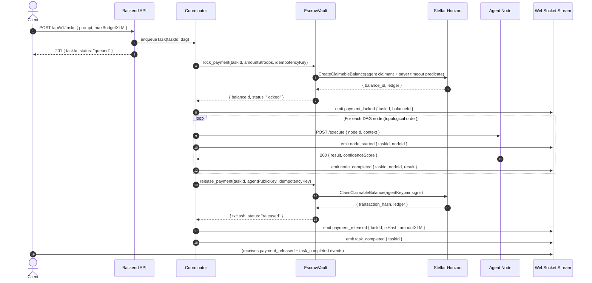
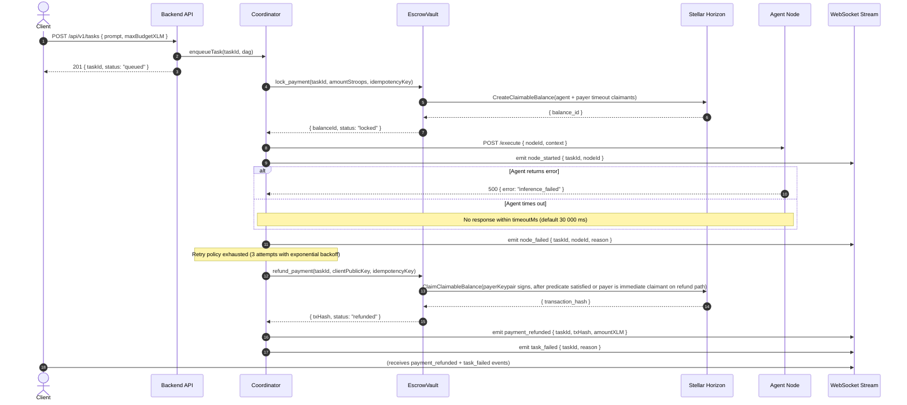
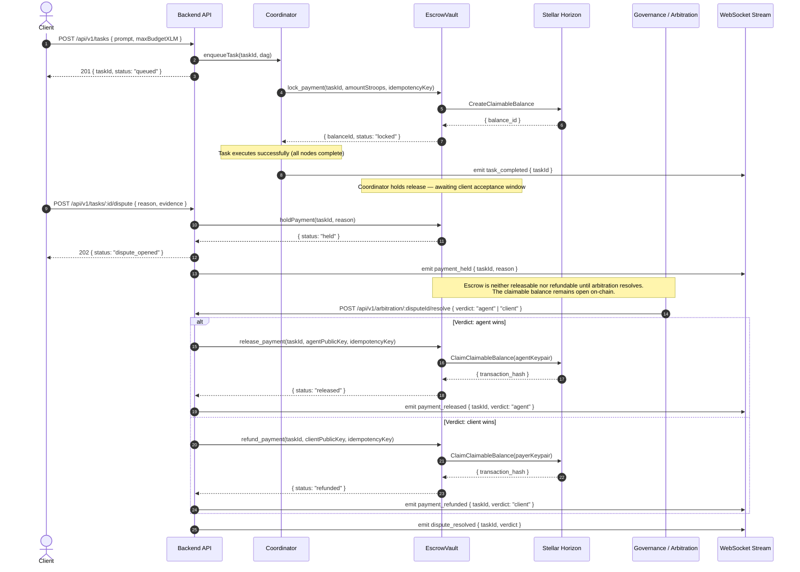

# Payment Lifecycle

This document describes how payments flow through ai-net from task submission to final settlement. All payments are implemented via Stellar claimable balances managed by the **EscrowVault** service. Three scenarios are covered: successful payment, failed-task refund, and disputed payment.

---

## Background: Stellar Claimable Balances

A **claimable balance** is a Stellar protocol primitive that holds an asset amount on-chain until a designated claimant satisfies optional predicates and claims it. ai-net uses claimable balances rather than a smart-contract escrow account because they provide:

1. **Native protocol guarantees** — the balance is held by the Stellar network itself; no custodian contract can misappropriate funds.
2. **Time-based predicates** — the claimant list can include a time-based predicate that allows the _payer_ to reclaim funds after a timeout, without requiring the agent's cooperation.
3. **Atomic finality** — a claim transaction either succeeds entirely on the ledger or fails; there is no partially-claimed state.

### How the EscrowVault Interacts with Horizon

The backend's `EscrowVault` constructs and submits Stellar transactions to the [Horizon REST API](https://developers.stellar.org/api/horizon). The lifecycle operations are:

| Operation         | Stellar transaction type                 | Horizon endpoint     |
| ----------------- | ---------------------------------------- | -------------------- |
| `lock_payment`    | `CreateClaimableBalance`                 | `POST /transactions` |
| `release_payment` | `ClaimClaimableBalance` (agent claimant) | `POST /transactions` |
| `refund_payment`  | `ClaimClaimableBalance` (payer claimant) | `POST /transactions` |

The EscrowVault stores the **claimable balance ID** (a 72-character hex string prefixed with `0000…`) in the `payments` database table alongside the `taskId` and `idempotency_key` so that operations can be resumed or verified after a process restart.

### Time-Based Unlock Predicate

When `lock_payment` creates a claimable balance it sets two claimants:

1. **Agent claimant** — can claim immediately (no predicate), valid until the `ESCROW_TIMEOUT_LEDGERS` deadline.
2. **Payer claimant** — can claim only _after_ `ESCROW_TIMEOUT_LEDGERS` have elapsed (a `ClaimPredicateNotBefore` predicate relative to the creation ledger).

This means the agent can claim the balance as soon as the coordinator releases it, but if the agent never claims it, the payer can recover the funds once the timeout passes without any on-chain governance step.

---

## XLM Stroop Precision

| Unit                         | Value                              |
| ---------------------------- | ---------------------------------- |
| 1 XLM                        | 10 000 000 stroops                 |
| Minimum escrow amount        | 1 000 000 stroops (0.1 XLM)        |
| Internal storage             | Always in stroops (integer)        |
| Wire format (`maxBudgetXLM`) | Decimal XLM string in API requests |

**Rounding rule:** amounts submitted as XLM strings are multiplied by 10 000 000 and truncated to the nearest integer stroop. No rounding up. A value of `0.00000001 XLM` truncates to 0 stroops and is rejected as below the minimum.

**Storage:** the `payments.amount_stroops` column is a 64-bit integer. The maximum representable amount (9 223 372 036 854 775 807 stroops ≈ 922 trillion XLM) is well above any realistic task budget.

---

## Idempotency Guarantees

Every mutating EscrowVault operation (`lock_payment`, `release_payment`, `refund_payment`) is guarded by an idempotency key stored in the `payments` table.

| Column            | Description                                               |
| ----------------- | --------------------------------------------------------- |
| `idempotency_key` | UUID v4 supplied by the caller                            |
| `operation`       | `lock` \| `release` \| `refund`                           |
| `result_hash`     | SHA-256 of the Stellar transaction XDR that was submitted |
| `created_at`      | ISO timestamp of the first execution                      |

**What happens if `release_payment` is called twice with the same key:**

1. The EscrowVault queries `SELECT * FROM payment_ops WHERE idempotency_key = ? AND operation = 'release'`.
2. If a row exists and `result_hash` is non-null, the stored Stellar transaction XDR is returned immediately — no on-chain call is made.
3. If a row exists but `result_hash` is null (a previous attempt started but did not receive a Horizon confirmation), the EscrowVault re-submits the original transaction XDR. Stellar deduplicates by transaction hash, so re-submitting the identical XDR is safe.
4. If no row exists, a new transaction is built, the row is inserted with a null `result_hash`, the transaction is submitted, and on confirmation the `result_hash` is written.

Idempotency keys expire after **24 hours**. After expiry, a new call with the same key starts a fresh operation.

---

## Concurrency Handling

Two callers attempting to `release_payment` for the same escrow simultaneously are safe at two levels:

1. **Stellar protocol level:** Stellar's ledger applies transactions sequentially. If two `ClaimClaimableBalance` transactions for the same balance ID reach Stellar Core at the same time, one is included in a ledger and the other fails with `CLAIM_CLAIMABLE_BALANCE_DOES_NOT_EXIST`. The failed transaction returns an error to the EscrowVault, which treats it as "already claimed" and queries the payment state.

2. **Contract level (database):** Before submitting to Horizon, the EscrowVault acquires a row-level advisory lock on `payments WHERE task_id = ?`. This prevents two Node.js worker processes from both reaching the Horizon submission step for the same payment simultaneously. Only one process proceeds; the other waits, then checks the idempotency key table and finds the first process's result.

---

## Testnet vs Mainnet Differences

| Parameter                           | Testnet                                         | Mainnet                                      |
| ----------------------------------- | ----------------------------------------------- | -------------------------------------------- |
| Base reserve                        | 0.5 XLM                                         | 0.5 XLM                                      |
| Minimum account balance             | 1.0 XLM (2 × base reserve)                      | 1.0 XLM                                      |
| Claimable balance base reserve cost | 0.5 XLM per balance                             | 0.5 XLM per balance                          |
| Transaction base fee                | 100 stroops (0.00001 XLM)                       | 100 stroops minimum; surge pricing may apply |
| Horizon URL                         | `https://horizon-testnet.stellar.org`           | `https://horizon.stellar.org`                |
| Friendbot available                 | Yes                                             | No                                           |
| Average ledger close time           | ~5 seconds                                      | ~5 seconds                                   |
| `ESCROW_TIMEOUT_LEDGERS` default    | 1 440 (≈ 2 hours)                               | 1 440 (≈ 2 hours)                            |
| Minimum recommended agent balance   | 10 XLM (covers 10–15 concurrent escrows + fees) | 20 XLM (surge fees during congestion)        |

**Important:** Testnet is periodically reset. All claimable balances, accounts, and contract state are wiped on a testnet reset. Node operators should not use testnet accounts for mainnet deployments.

---

## Monitoring Payment State via Horizon

To determine whether a specific claimable balance is still open, claimed, or stuck:

### 1. Query the balance by ID

```bash
curl "https://horizon-testnet.stellar.org/claimable_balances/\
00000000<balance_id_hex>"
```

### 2. Interpret the response fields

| Field                  | Meaning                                                      |
| ---------------------- | ------------------------------------------------------------ |
| `id`                   | The balance ID (use this to look it up)                      |
| `asset`                | Should be `native` for XLM escrows                           |
| `amount`               | Current balance in XLM (not stroops)                         |
| `claimants`            | Array of claimant objects with `destination` and `predicate` |
| `last_modified_ledger` | Last ledger that touched this balance                        |
| `paging_token`         | For cursor-based pagination                                  |

If the endpoint returns **HTTP 404**, the balance has been claimed or was never created. Check the `payments` table's `result_hash` column to determine which.

### 3. Find a balance by task ID

The EscrowVault stores the balance ID in `payments.claimable_balance_id`. Query:

```sql
SELECT claimable_balance_id, status, amount_stroops, created_at
FROM payments
WHERE task_id = '<task_id>';
```

Then use the `claimable_balance_id` with the Horizon query above.

### 4. Signs a balance may be stuck

- Balance is still open more than `ESCROW_TIMEOUT_LEDGERS` after creation.
- The agent's claim transaction failed with an error other than `CLAIM_CLAIMABLE_BALANCE_DOES_NOT_EXIST`.
- The `payments` row has `status = 'locked'` for longer than the configured timeout.

The Sentinel background process checks for stuck balances every 10 minutes and pages the on-call operator.

---

## Scenario 1: Successful Task Payment

This diagram shows the happy path: the client submits a task, payment is locked in escrow, the task executes successfully, and the coordinator releases the payment to the agent.



---

## Scenario 2: Failed Task Refund

This diagram shows the failure path: the agent fails (or times out) and the coordinator refunds the locked escrow to the client.



---

## Scenario 3: Disputed Payment

This diagram shows the dispute path: the task nominally completes but the client challenges the result. The escrow enters a held state pending arbitration.



---

## Related Documentation

- [Glossary](../docs/GLOSSARY.md) — definitions for Escrow, EscrowVault, Claimable Balance, Stroops, Idempotency Key, and more
- [Task Store Events](../smart-contracts/docs/TASK_STORE_EVENTS.md) — on-chain event schema for task lifecycle transitions
- [REST API Reference](API_REFERENCE.md) — payment endpoint documentation
- [Node Operators Guide](NODE_OPERATORS_GUIDE.md) — monitoring and operational procedures
- [Dispute Resolution Guide](DISPUTE_RESOLUTION_GUIDE.md) — full arbitration workflow
- [Operational Runbooks](operations/RUNBOOKS.md) — incident response for stuck payments
