# Threat Model — ai-net

**Last updated:** 2026-08-29  
**Scope:** smart-contracts (coordinator, payment, registry), backend services, frontend

---

## 1. Trust Boundaries

| Boundary | Trust Level | Notes |
|----------|-------------|-------|
| **User Browser** → Backend API | Low | All input untrusted; validate + sanitize |
| **Backend API** → Stellar Horizon | Medium | Requires valid keypair; Horizon may be slow/malicious |
| **Backend API** → Agent HTTP endpoints | Low | Agents are external; responses may be malformed or hostile |
| **Coordinator** → Payment Service | High | Internal; same process, but follows defense-in-depth |
| **Coordinator** → DB (SQLite) | High | Local file; WAL mode; no network access |
| **Registry** → Agent Registration | Low | Anyone can register; reputation gated by coordinator |
| **Frontend** → Backend API | Low | Wallet-signed requests; CSRF via SameSite cookies |

---

## 2. Access-Control Matrix

| Component | Can Sign Tx | Can Claim Balance | Can Read DB | Can Write DB | Can Deregister Agents |
|-----------|-------------|-------------------|-------------|--------------|----------------------|
| Coordinator | Yes (keypair) | Yes (sole claimant) | Yes | Yes | Yes |
| Agent | No | No | No | No | No |
| User/Browser | No (wallet signs) | No | No | No | No |
| Payment Service | Yes (via coordinator) | Yes (via coordinator) | Yes (payment DB) | Yes (payment DB) | No |

---

## 3. Reentrancy & Replay Notes

### 3.1 Stellar Claimable Balances
- **Reentrancy risk:** LOW. `releasePayment` atomically claims + pays in a single Stellar transaction. No intermediate state is observable.
- **Replay protection:** Stellar transactions include `sequence` numbers. Each tx is unique. The `setTimeout(180)` envelope prevents stale tx submission.
- **Double-release protection:** `EscrowAlreadySettledError` thrown if balance already claimed. Horizon returns 404 for non-existent balances.

### 3.2 Task Execution
- **DAG execution:** Each node runs once. Topological sort ensures dependency ordering. `handleAgentFailure` retries with fallback agents (max 3 per agent, tries all registered).
- **Concurrent task execution:** `ConcurrencyLimiter` caps parallel nodes (default 3). No shared mutable state between concurrent node executions.

### 3.3 Coordinator Dispatch
- **Replay:** HTTP requests to agents include `X-Correlation-ID` for tracing. Agent idempotency is the agent's responsibility.
- **Timeout handling:** `AbortController` enforces `timeoutMs`. Aborted requests throw `RetryableAgentError`.

---

## 4. Storage-Rent Risks (Soroban Migration)

| Data | Current | Soroban Risk | Mitigation |
|------|---------|--------------|------------|
| Task metadata | In-memory / DB | High — Soroban charges rent for storage | TTL-based expiry (`ttlDays`); `store_task_metadata` accepts TTL |
| Agent registry | In-memory with TTL | Medium — agents re-register periodically | 30s TTL cache; expired entries pruned |
| Payment records | SQLite | N/A (off-chain) | Already off-chain; on-chain is Stellar claimable balances |
| Execution traces | Filesystem (`logs/tasks/`) | N/A | Cron cleanup; not on-chain |

**Known limitation:** In-memory registry is ephemeral. On crash, all registrations lost. Soroban migration will fix this.

---

## 5. Known Limitations

1. **In-memory registry** — Lost on restart. Agents must re-register. No persistence across process restarts.
2. **Coordinator keypair in env** — `STELLAR_SECRET_KEY` in environment variables. If compromised, full escrow control. Mitigation: use a signing service / HSM in production.
3. **Memo.text 28-byte limit** — Task IDs longer than 28 bytes (UTF-8) cannot be used as Stellar memos. `lockEscrow` enforces this.
4. **1e-7 precision bug** — `xlmToStroops(1e-7)` throws because JS renders small numbers in scientific notation. Only affects bare `number` inputs; string `'0.0000001'` works.
5. **Retry cap** — `handleAgentFailure` retries up to 3 times per agent. If all agents for a type are exhausted, the node fails permanently. No infinite retry.
6. **Horizon dependency** — Payment operations depend on Stellar Horizon availability. Exponential backoff retries on 429/504, but prolonged outages will cascade.

---

## 6. Audit Slots

Each contract/module has a designated audit focus area:

| Module | Audit Focus | Key Questions |
|--------|-------------|---------------|
| **Coordinator** | DAG execution correctness | Is topological sort correct? Can failure cascade be exploited? |
| **Payment** | Escrow atomicity | Can double-claim occur? Are refund/release race conditions safe? |
| **Registry** | Access control | Can unregistered agents be assigned tasks? Is reputation manipulation possible? |
| **Backend API** | Input validation | Are all endpoints schema-validated? Is rate limiting enforced? |
| **Frontend** | XSS / wallet security | Are secret keys handled safely? Is CSP configured? |

---

## 7. Release Gating

**Before tagging a release:**
1. All items in `SECURITY_CHECKLIST.md` must be checked.
2. No CRITICAL or HIGH security findings from the checklist are open.
3. Fault injection tests pass in CI.
4. Reconciliation job detects drift within 5 minutes.
5. i18n parity test confirms en/zh key equality.

---

## Appendix: Contract-Level Audit Checklist

- [ ] Coordinator: `CyclicDAGError` thrown for circular deps
- [ ] Coordinator: `handleAgentFailure` retries correctly across agents
- [ ] Coordinator: `MAX_RETRIES` enforced per agent
- [ ] Payment: `lockEscrow` memo size validated
- [ ] Payment: `releasePayment` atomic claim+pay
- [ ] Payment: `refundEscrow` idempotent (returns same tx or throws)
- [ ] Payment: `getEscrowBalance` returns 0 for settled balances
- [ ] Registry: `clearRegistry` isolates tests
- [ ] Registry: Composite index sorted correctly
- [ ] Registry: TTL expiry removes stale agents

---

## 8. On-Chain Attack Vectors (Soroban / Stellar Layer)

This section extends the threat model to cover attack vectors specific to the Soroban smart contract layer. Each threat is analyzed with likelihood, impact, current mitigations, and recommended improvements.

---

### 8.1 Oracle Price Manipulation

**Description:** The agent bidding system or fee calculation logic may reference an on-chain oracle to price tasks in USD-equivalent or XLM terms. An attacker who controls or can influence a majority of oracle feeder accounts can submit manipulated price data, inflating or deflating task fees — extracting value or pricing legitimate agents out of tasks.

| Attribute | Detail |
|---|---|
| **Likelihood** | Medium — oracle manipulation is common in DeFi; ai-net's oracle surface is smaller but not zero |
| **Impact** | High — incorrect pricing corrupts escrow lock amounts; over-payment burns coordinator funds |
| **Current mitigation** | Task `budgetXlm` is set by the task submitter, not derived from an oracle; no external price feed is currently used |
| **Recommended improvement** | If a price oracle is introduced: enforce a minimum number of independent feeders (≥5), use a time-weighted median (TWAP/TWAM), reject inputs deviating >20% from the rolling median, and emit `OraclePriceAnomalyEvent` on deviation |

---

### 8.2 Governance Capture

**Description:** An attacker accumulates enough staked tokens or governance weight to unilaterally pass malicious upgrade proposals — for example, deploying a backdoored WASM that redirects escrow funds to an attacker-controlled account, or disabling the `require_auth()` check on `slash_bond`.

| Attribute | Detail |
|---|---|
| **Likelihood** | Low — currently the governance system requires multi-sig (2-of-3 keyholders), not token-weighted voting |
| **Impact** | Critical — a successful governance capture gives full control over all contract logic and funds |
| **Current mitigation** | Upgrade Manager enforces a 48-hour timelock between `propose_upgrade` and `execute_upgrade`; 2-of-3 multi-sig required for execution; all proposals and executions are logged via `AuditLogEntryEvent` |
| **Recommended improvement** | Add a community veto window: allow any staked participant to raise a `VetoProposal` event within the timelock period; require a 7-day timelock for MAJOR version upgrades; publish WASM hashes publicly before execution |

**Linked contract feature:** `upgrade_manager::propose_upgrade`, `upgrade_manager::execute_upgrade`, `set_multisig_config`

---

### 8.3 Bid Sniping (Front-Running)

**Description:** In the agent bidding system, an attacker monitors the Stellar mempool (transaction pool) for winning `reveal_bid` transactions. Because Stellar processes transactions in ledger order and the attacker can submit a transaction with a higher fee, they can front-run the legitimate winner's reveal, submitting their own reveal just ahead of it in the same ledger close.

| Attribute | Detail |
|---|---|
| **Likelihood** | Medium — Stellar's 5-second ledger time limits the window, but mempools on public RPC nodes are observable |
| **Impact** | Medium — legitimate bidders lose tasks they should have won; reputation score manipulation possible via repeated sniping |
| **Current mitigation** | Commit-reveal scheme: bids are submitted as hash commitments in phase 1 and revealed in phase 2 (see `agent_bidding` contract); the reveal window is ledger-bounded |
| **Recommended improvement** | Implement sealed-bid finality: accept reveals only from the original committer address; add a `bid_nonce` to commitments so hash values are unpredictable even if the bid amount is guessed; emit `BidSnipingDetectedEvent` when two reveals for the same task arrive within one ledger |

**Linked contract feature:** `agent_bidding::commit_bid`, `agent_bidding::reveal_bid`

---

### 8.4 Escrow Drain via Partial Release Vulnerability

**Description:** An attacker exploits a race condition or logic flaw in the `payment_escrow` contract to claim the escrow balance multiple times before the `EscrowAlreadySettledError` guard fires — or triggers a partial `releasePayment` followed by a `refundEscrow` on the same balance.

| Attribute | Detail |
|---|---|
| **Likelihood** | Low — Stellar's atomic transaction model makes true reentrancy impossible; however, logic bugs in multi-step release flows remain possible |
| **Impact** | Critical — full escrow balance lost; direct XLM theft from coordinator |
| **Current mitigation** | `releasePayment` atomically claims + pays in a single Stellar transaction; `EscrowAlreadySettledError` thrown on double-release; `getEscrowBalance` returns 0 for settled balances (tested in fault injection suite, F5/F6) |
| **Recommended improvement** | Add a state machine check at the contract level: escrow must be in `Locked` state before `releasePayment` or `refundEscrow` can execute; track state in `Temporary` storage; add an invariant test asserting `lock_count == release_count + refund_count` after every E2E test run |

**Linked contract feature:** `payment_escrow::releasePayment`, `payment_escrow::refundEscrow`, `payment_escrow::lockEscrow`

---

### 8.5 Reputation Inflation via Fake Completed Tasks

**Description:** An attacker controls both a coordinator account and an agent account. They submit minimal tasks from the coordinator to their own agent, immediately confirm completion, and receive on-chain reputation score increments — allowing the attacker's agent to climb the registry ranking without performing real work. High-reputation agents receive preferential task assignment.

| Attribute | Detail |
|---|---|
| **Likelihood** | Medium — self-dealing between colluding accounts is difficult to prevent purely on-chain |
| **Impact** | Medium — degrades task assignment quality; legitimate agents are out-competed by fake-reputation actors |
| **Current mitigation** | Task quality is scored by the coordinator based on output validation; `qualityScore` is not incremented by on-chain events alone; the coordinator validates agent output before emitting a `TaskCompleted` event |
| **Recommended improvement** | Enforce a minimum `budgetXlm` per task to raise the cost of Sybil reputation farming; add a cooldown period between task completions for new agents; implement cross-agent reputation decay (unused agents' scores depreciate over time); consider requiring a minimum task complexity score signed by the coordinator |

**Linked contract feature:** `agent_registry::update_reputation`, coordinator task completion flow

---

### 8.6 Upgrade Attack via Compromised Upgrade Manager

**Description:** If the `upgrade_manager` admin keypair is compromised, an attacker can call `propose_upgrade` and `execute_upgrade` to deploy arbitrary WASM — including backdoored logic that bypasses `require_auth()`, drains escrow, or corrupts registry state.

| Attribute | Detail |
|---|---|
| **Likelihood** | Low — admin keys are kept off-chain; however, leaked environment variables or compromised CI runners are realistic attack vectors |
| **Impact** | Critical — arbitrary code execution on all contracts managed by the upgrade manager |
| **Current mitigation** | 48-hour timelock on all upgrades; 2-of-3 multi-sig required; all upgrade events are logged on-chain; `AnomalyDetectedEvent` fires for `FirstSeenCaller` and `RateExceeded` patterns on the upgrade manager |
| **Recommended improvement** | Store admin keys in a hardware security module (HSM) or cloud KMS for mainnet; never use the same key for CI testnet deployments and mainnet admin; rotate admin keys quarterly; add a `FreezeUpgrades` function that allows any multi-sig member to pause all upgrade operations for 24 hours if compromise is suspected |

**Linked contract feature:** `upgrade_manager::propose_upgrade`, `upgrade_manager::execute_upgrade`, `agent_registry::set_admin`, audit log (`security.md`)

---

### 8.7 Denial of Service via Gas Exhaustion on Unbounded Loops

**Description:** An attacker registers a large number of agents with identical capability tags, then triggers a `get_agents_by_capability` query that iterates over the entire set. If the loop is unbounded, the transaction exceeds Soroban's per-transaction gas limit, causing it to abort — effectively preventing all agents of that capability from being discovered until the attacker's entries expire.

| Attribute | Detail |
|---|---|
| **Likelihood** | Medium — the registry uses pagination cursors, but the enforcement of cursor bounds inside contract code must be verified |
| **Impact** | High — task assignment for an entire capability class becomes impossible; cascades to coordinator failures |
| **Current mitigation** | AGENTS.md invariant: "avoid unbounded vectors in contract storage; enforce pagination cursors on collections"; `MAX_AUDIT_PAGE_SIZE` = 50 enforced in the audit log; similar limits should apply to agent listing |
| **Recommended improvement** | Audit all `for` loops and iterator chains in contract code for unbounded traversal; enforce a hard `max_items` parameter on all list/query functions (suggested: 100); add a CI test that registers 500 agents and verifies the query returns within gas budget; emit a `RegistryCapacityWarning` event when capability-class size exceeds 80% of the safe limit |

**Linked contract feature:** `agent_registry::get_agents_by_capability`, `agent_registry::list_agents`

---

## 9. Payment Escrow Attack Tree (Mermaid)

The following diagram models the attack surface of the payment escrow flow. Each leaf node represents a concrete attack technique; intermediate nodes are attack goals.

```mermaid
graph TD
    Root["💰 Drain Escrow Funds"]

    Root --> A["Exploit Smart Contract Logic"]
    Root --> B["Compromise Key Material"]
    Root --> C["Manipulate Task Lifecycle"]

    A --> A1["Double-Release: call releasePayment twice\n→ Mitigated: EscrowAlreadySettledError"]
    A --> A2["Race Condition: releasePayment + refundEscrow\n→ Mitigated: atomic Stellar tx, state machine"]
    A --> A3["Overflow: manipulate budgetXlm to overflow stroops\n→ Mitigated: xlmToStroops validates input format"]
    A --> A4["Replay: submit stale signed Stellar tx\n→ Mitigated: sequence numbers + setTimeout(180)"]

    B --> B1["Steal STELLAR_SECRET_KEY from env\n→ Mitigated: HSM recommended, key rotation"]
    B --> B2["Compromise CI runner to exfiltrate keys\n→ Mitigated: secrets stored in CI vault, not source"]
    B --> B3["Compromise upgrade_manager admin key\n→ Mitigated: 48h timelock, 2-of-3 multi-sig"]

    C --> C1["Mark task complete without real output\n→ Mitigated: coordinator validates output before settle"]
    C --> C2["Submit fake tasks to own agent for reputation\n→ Mitigated: min budgetXlm, quality scoring"]
    C --> C3["Delay task completion past timeout to trigger refund\n→ Mitigated: AbortController timeout, retry budget"]
    C --> C4["Flood task queue to starve legitimate tasks\n→ Mitigated: per-wallet rate limits, daily quotas"]
```

---

## 10. Security Checklist Updates

The following items have been added to [`SECURITY_CHECKLIST.md`](./SECURITY_CHECKLIST.md) based on the on-chain threat analysis above:

| ID | Check | Threat Addressed |
|---|---|---|
| **OC1** | Verify `releasePayment` cannot be called on an escrow in any state other than `Locked` | 8.4 Escrow Drain |
| **OC2** | Verify all list/query functions in registry contracts have a hard `max_items` limit ≤ 100 | 8.7 Gas DoS |
| **OC3** | Verify upgrade_manager admin keypair is stored in HSM or KMS for mainnet | 8.6 Upgrade Attack |
| **OC4** | Verify commit-reveal bid scheme prevents reveal by non-committer address | 8.3 Bid Sniping |
| **OC5** | Verify reputation score increments require off-chain quality validation signature | 8.5 Reputation Inflation |
| **OC6** | Verify `propose_upgrade` → `execute_upgrade` enforces a minimum 48-hour gap on-chain | 8.2 Governance Capture |
| **OC7** | Confirm no external price oracle is used without TWAP and deviation guards | 8.1 Oracle Manipulation |
