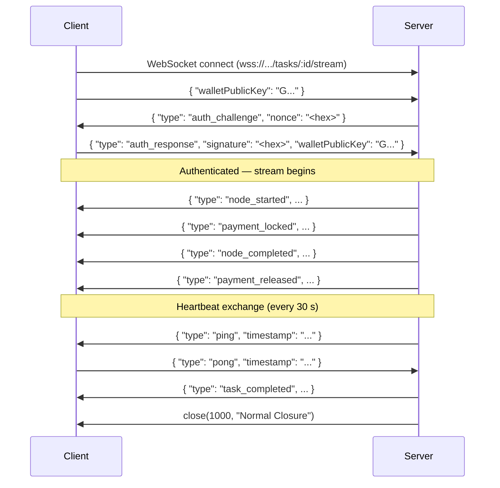

# WebSocket API Reference

## Table of Contents

1. [Overview](#1-overview)
2. [Connection URL](#2-connection-url)
3. [Authentication](#3-authentication)
4. [Event Types](#4-event-types)
5. [Heartbeat Protocol](#5-heartbeat-protocol)
6. [Reconnection Strategy](#6-reconnection-strategy)
7. [Close Codes](#7-close-codes)
8. [JavaScript Code Example](#8-javascript-code-example)
9. [Connection Lifecycle Diagram](#9-connection-lifecycle-diagram)

---

## 1. Overview

The WebSocket streaming API is the only way to receive live task progress without polling. Once connected to a task stream, the server pushes structured JSON events as each agent node starts, completes, or fails, and as Stellar payments are locked or released. The connection stays open until the task reaches a terminal state (`task_completed` or `task_failed`) or the client disconnects.

For task status at a point in time, use `GET /api/tasks/:id` instead. The WebSocket stream is for clients that need real-time updates as execution unfolds.

---

## 2. Connection URL

```
wss://<host>/tasks/:id/stream
```

| Environment       | Example                                                                |
| ----------------- | ---------------------------------------------------------------------- |
| Local development | `ws://localhost:3000/tasks/task_ab12cd34ef56/stream`                   |
| Testnet           | `wss://api.testnet.ai-net.epta-node.io/tasks/task_ab12cd34ef56/stream` |
| Production        | `wss://api.ai-net.io/tasks/task_ab12cd34ef56/stream`                   |

Use `ws://` (unencrypted) for local development only. All non-local environments require `wss://` (TLS).

**Path parameter**

| Parameter | Description                                                          |
| --------- | -------------------------------------------------------------------- |
| `:id`     | The task ID returned by `POST /api/tasks` (e.g. `task_ab12cd34ef56`) |

**Query parameters**

| Parameter | Type                          | Description                                                                                                                                |
| --------- | ----------------------------- | ------------------------------------------------------------------------------------------------------------------------------------------ |
| `since`   | `string` (ISO-8601 timestamp) | Replay events that occurred after this timestamp. Use the timestamp of the last received event when reconnecting to avoid missing updates. |

**Example with replay cursor**

```
wss://api.ai-net.io/tasks/task_ab12cd34ef56/stream?since=2026-09-30T11:05:00.000Z
```

---

## 3. Authentication

The WebSocket stream uses a challenge-response handshake over the connection itself. No HTTP headers are used for authentication.

### Step 1 — Send initial identity message

Immediately after the connection opens, send:

```json
{
  "walletPublicKey": "GBZXN7PIRZGNMHGA728XZVOG2GUFIDLAZ6AF2I2MD2OCYTAF2K1K4AAA"
}
```

### Step 2 — Receive challenge

The server responds with a nonce to sign:

```json
{
  "type": "auth_challenge",
  "nonce": "a3f8c2d1e9b04765..."
}
```

The nonce is a hex-encoded random value. It is single-use and expires after 30 seconds.

### Step 3 — Sign and respond

Sign the nonce with the Ed25519 private key corresponding to the wallet address, then send:

```json
{
  "type": "auth_response",
  "signature": "3045022100...",
  "walletPublicKey": "GBZXN7PIRZGNMHGA728XZVOG2GUFIDLAZ6AF2I2MD2OCYTAF2K1K4AAA"
}
```

The signature must cover the raw nonce bytes (not hex-decoded — sign the hex string as UTF-8). Use the Stellar SDK's `Keypair.sign()` method.

### Authentication failure

If authentication fails for any reason, the server closes the connection with code `4001`. See [Close Codes](#7-close-codes) for the full list of failure codes.

### Session lifetime

An authenticated session lasts 24 hours or until the task reaches a terminal state, whichever comes first. After 24 hours the server closes with code `4011` (Session Expired). Clients should reconnect and re-authenticate.

---

## 4. Event Types

All events are JSON objects sent as WebSocket text frames. Every event includes at minimum a `type` field and the `taskId` it belongs to.

### TypeScript interfaces

```typescript
interface NodeStartedEvent {
  type: "node_started";
  taskId: string;
  nodeId: string;
  agentType: "research" | "coding" | "design" | "risk" | "report";
  startedAt: string; // ISO-8601
  estimatedDurationMs: number;
}

interface NodeCompletedEvent {
  type: "node_completed";
  taskId: string;
  nodeId: string;
  agentType: "research" | "coding" | "design" | "risk" | "report";
  completedAt: string;
  durationMs: number;
  result: {
    summary: string;
    outputTokens: number;
    cached: boolean;
  };
}

interface NodeFailedEvent {
  type: "node_failed";
  taskId: string;
  nodeId: string;
  agentType: "research" | "coding" | "design" | "risk" | "report";
  failedAt: string;
  errorCode: string;
  errorMessage: string;
  retryable: boolean;
  attemptNumber: number;
  maxAttempts: number;
}

interface PaymentLockedEvent {
  type: "payment_locked";
  taskId: string;
  nodeId: string;
  claimableBalanceId: string;
  amountStroops: string;
  lockedAt: string;
}

interface PaymentReleasedEvent {
  type: "payment_released";
  taskId: string;
  nodeId: string;
  recipient: string; // Stellar public key G...
  amountStroops: string;
  transactionHash: string;
  releasedAt: string;
}

interface TaskCompletedEvent {
  type: "task_completed";
  taskId: string;
  completedAt: string;
  durationMs: number;
  result: {
    summary: string;
    nodeResults: Record<string, { summary: string; outputTokens: number }>;
    totalOutputTokens: number;
  };
}

interface TaskFailedEvent {
  type: "task_failed";
  taskId: string;
  failedAt: string;
  terminalError: string;
  errorCode: string;
  refundStatus: "pending" | "completed" | "not_applicable";
  refundTransactionHash: string | null;
}

type TaskStreamEvent =
  | NodeStartedEvent
  | NodeCompletedEvent
  | NodeFailedEvent
  | PaymentLockedEvent
  | PaymentReleasedEvent
  | TaskCompletedEvent
  | TaskFailedEvent;
```

### Event descriptions

| Event type         | When emitted                                  | Terminal? |
| ------------------ | --------------------------------------------- | --------- |
| `node_started`     | An agent node has begun execution             | No        |
| `node_completed`   | An agent node finished successfully           | No        |
| `node_failed`      | An agent node failed; may retry               | No        |
| `payment_locked`   | XLM escrowed into a Stellar claimable balance | No        |
| `payment_released` | Claimable balance claimed by the agent        | No        |
| `task_completed`   | All nodes finished; task is done              | **Yes**   |
| `task_failed`      | Task ended with an unrecoverable error        | **Yes**   |

After a terminal event (`task_completed` or `task_failed`) the server closes the connection cleanly with code `1000`.

### Replayed events

Events received when a `?since=` cursor was supplied include an additional field:

```json
{ "isReplay": true }
```

Treat replayed events idempotently — they describe state that already occurred and must not trigger duplicate side effects (e.g. duplicate UI notifications or duplicate payment processing).

---

## 5. Heartbeat Protocol

The server sends a ping every 30 seconds to detect stale connections:

```json
{
  "type": "ping",
  "timestamp": "2026-09-30T11:07:12.000Z"
}
```

The client must respond within 10 seconds:

```json
{
  "type": "pong",
  "timestamp": "2026-09-30T11:07:12.123Z"
}
```

If no pong is received within 10 seconds, the server closes the connection with code `1001` (Going Away). The client should treat this as a normal disconnect and apply the [reconnection strategy](#6-reconnection-strategy).

> **Implementation note:** some WebSocket libraries handle protocol-level ping/pong frames automatically. The ping/pong here is application-level (JSON text frames), so it must be handled explicitly in application code.

---

## 6. Reconnection Strategy

Network interruptions are expected. Clients should reconnect automatically using exponential backoff.

### Backoff parameters

| Parameter        | Value          |
| ---------------- | -------------- |
| Base delay       | 1 second       |
| Multiplier       | 2× per attempt |
| Maximum delay    | 30 seconds     |
| Maximum attempts | 10             |

**Delay sequence:** 1 s, 2 s, 4 s, 8 s, 16 s, 30 s, 30 s, 30 s, 30 s, 30 s

After 10 failed attempts without a successful connection, surface an error to the user and stop retrying.

### Replaying missed events

On reconnect, include the timestamp of the last successfully processed event as the `?since=` query parameter:

```
wss://api.ai-net.io/tasks/task_ab12cd34ef56/stream?since=2026-09-30T11:05:33.000Z
```

The server replays all events that occurred after that timestamp. Replayed events include `"isReplay": true` and must be handled idempotently.

### Reset on successful connection

Reset the attempt counter to zero once a connection is established and the auth handshake completes successfully.

---

## 7. Close Codes

The server uses a mix of standard WebSocket close codes and custom codes in the `4000–4099` range.

| Code   | Name                   | Description                                                                  |
| ------ | ---------------------- | ---------------------------------------------------------------------------- |
| `1000` | Normal Closure         | Task completed or client disconnected cleanly                                |
| `1001` | Going Away             | Server closing due to missed pong or planned shutdown                        |
| `1008` | Policy Violation       | Message format invalid or unexpected message type                            |
| `1011` | Internal Error         | Unexpected server error                                                      |
| `4000` | Bad Request            | Malformed first message (not valid JSON or missing `walletPublicKey`)        |
| `4001` | Unauthorized           | Authentication failed or signature invalid                                   |
| `4002` | Task Not Found         | The task ID in the URL does not exist                                        |
| `4003` | Task Already Terminal  | Task is already completed or failed; use `GET /api/tasks/:id` for the result |
| `4004` | Quota Exceeded         | Wallet has exceeded the daily WebSocket connection limit                     |
| `4005` | Rate Limited           | Too many connection attempts; apply backoff before retrying                  |
| `4010` | Invalid Nonce Response | Auth response signature did not match the challenge nonce                    |
| `4011` | Session Expired        | The 24-hour session lifetime was exceeded; reconnect and re-authenticate     |
| `4099` | Server Overloaded      | Node is at capacity; retry after the standard backoff interval               |

Codes `4000`, `4001`, `4002`, `4003`, and `4010` indicate a problem the client must fix before retrying. Codes `4004`, `4005`, and `4099` are transient — apply the reconnection strategy. Code `4011` requires a fresh auth handshake on the next connection.

---

## 8. JavaScript Code Example

The following self-contained class handles the full connection lifecycle: authentication, event dispatch, heartbeat, reconnection with backoff, and clean close.

```javascript
import { Keypair } from "@stellar/stellar-sdk";

class TaskStreamClient {
  #url;
  #keypair;
  #handlers = {};
  #ws = null;
  #lastEventTimestamp = null;
  #attemptNumber = 0;
  #maxAttempts = 10;
  #baseDelayMs = 1000;
  #maxDelayMs = 30000;
  #pongTimeoutId = null;
  #reconnectTimeoutId = null;
  #closed = false;

  /**
   * @param {string} taskId     - Task ID to stream (e.g. "task_ab12cd34ef56")
   * @param {string} host       - WebSocket host (e.g. "api.ai-net.io")
   * @param {Keypair} keypair   - Stellar Keypair for signing the auth challenge
   */
  constructor(taskId, host, keypair) {
    const protocol = host.startsWith("localhost") ? "ws" : "wss";
    this.#url = `${protocol}://${host}/tasks/${taskId}/stream`;
    this.#keypair = keypair;
  }

  /** Register a handler for a specific event type. */
  on(eventType, handler) {
    this.#handlers[eventType] = handler;
    return this;
  }

  /** Open the connection. Reconnects automatically on failure. */
  connect() {
    this.#closed = false;
    this.#openConnection();
  }

  /** Close the connection and stop reconnecting. */
  close() {
    this.#closed = true;
    clearTimeout(this.#reconnectTimeoutId);
    clearTimeout(this.#pongTimeoutId);
    if (this.#ws) {
      this.#ws.close(1000, "Client closed");
    }
  }

  #openConnection() {
    const url = this.#lastEventTimestamp
      ? `${this.#url}?since=${encodeURIComponent(this.#lastEventTimestamp)}`
      : this.#url;

    this.#ws = new WebSocket(url);

    this.#ws.addEventListener("open", () => {
      // Step 1: send wallet identity
      this.#send({ walletPublicKey: this.#keypair.publicKey() });
    });

    this.#ws.addEventListener("message", (event) => {
      let msg;
      try {
        msg = JSON.parse(event.data);
      } catch {
        console.error("Received non-JSON message:", event.data);
        return;
      }
      this.#handleMessage(msg);
    });

    this.#ws.addEventListener("close", (event) => {
      clearTimeout(this.#pongTimeoutId);
      this.#handleClose(event.code, event.reason);
    });

    this.#ws.addEventListener("error", (err) => {
      console.error("WebSocket error:", err);
      // 'close' fires after 'error'; reconnection logic lives there.
    });
  }

  #handleMessage(msg) {
    // Auth handshake
    if (msg.type === "auth_challenge") {
      const nonce = msg.nonce;
      const signatureBytes = this.#keypair.sign(Buffer.from(nonce, "utf8"));
      this.#send({
        type: "auth_response",
        signature: signatureBytes.toString("hex"),
        walletPublicKey: this.#keypair.publicKey(),
      });
      return;
    }

    // Heartbeat
    if (msg.type === "ping") {
      this.#send({ type: "pong", timestamp: new Date().toISOString() });
      clearTimeout(this.#pongTimeoutId);
      return;
    }

    // Task stream events
    const handler = this.#handlers[msg.type];
    if (handler) {
      handler(msg);
    }

    // Track last event timestamp for reconnect cursor
    const ts =
      msg.startedAt ??
      msg.completedAt ??
      msg.failedAt ??
      msg.lockedAt ??
      msg.releasedAt;
    if (ts) {
      this.#lastEventTimestamp = ts;
    }

    // After a terminal event the server closes cleanly; nothing to do here.
  }

  #handleClose(code, reason) {
    if (this.#closed) return;

    // Non-retriable codes: client must fix something first
    const fatal = new Set([4000, 4001, 4002, 4003, 4010]);
    if (fatal.has(code)) {
      console.error(`Stream closed with fatal code ${code}: ${reason}`);
      this.#closed = true;
      this.#handlers["error"]?.({ code, reason });
      return;
    }

    // Normal terminal close — task is done
    if (code === 1000) {
      this.#attemptNumber = 0;
      return;
    }

    // Session expired: reconnect triggers a fresh auth handshake automatically
    // (the server will issue a new challenge on the next connection)

    this.#scheduleReconnect();
  }

  #scheduleReconnect() {
    if (this.#attemptNumber >= this.#maxAttempts) {
      console.error("Max reconnection attempts reached. Giving up.");
      this.#handlers["error"]?.({
        code: null,
        reason: "Max attempts exceeded",
      });
      return;
    }

    const delay = Math.min(
      this.#baseDelayMs * Math.pow(2, this.#attemptNumber),
      this.#maxDelayMs,
    );
    this.#attemptNumber += 1;
    console.log(
      `Reconnecting in ${delay}ms (attempt ${this.#attemptNumber}/${this.#maxAttempts})`,
    );

    this.#reconnectTimeoutId = setTimeout(() => {
      this.#openConnection();
    }, delay);
  }

  #send(payload) {
    if (this.#ws?.readyState === WebSocket.OPEN) {
      this.#ws.send(JSON.stringify(payload));
    }
  }
}

// --- Usage ---

const keypair = Keypair.fromSecret(
  "SXXXXXXXXXXXXXXXXXXXXXXXXXXXXXXXXXXXXXXXXXXXXXXXXXXXXXXX",
);

const client = new TaskStreamClient(
  "task_ab12cd34ef56",
  "api.ai-net.io",
  keypair,
)
  .on("node_started", (event) => {
    console.log(`[${event.agentType}] node ${event.nodeId} started`);
  })
  .on("node_completed", (event) => {
    console.log(
      `[${event.agentType}] node ${event.nodeId} done in ${event.durationMs}ms`,
    );
    console.log("  Summary:", event.result.summary);
  })
  .on("node_failed", (event) => {
    console.warn(
      `[${event.agentType}] node ${event.nodeId} failed (attempt ${event.attemptNumber}/${event.maxAttempts}):`,
      event.errorMessage,
    );
  })
  .on("payment_locked", (event) => {
    console.log(
      `Payment locked for node ${event.nodeId}: ${event.amountStroops} stroops`,
    );
  })
  .on("payment_released", (event) => {
    console.log(
      `Payment released to ${event.recipient}: tx ${event.transactionHash}`,
    );
  })
  .on("task_completed", (event) => {
    console.log(`Task completed in ${event.durationMs}ms`);
    console.log("Summary:", event.result.summary);
    client.close();
  })
  .on("task_failed", (event) => {
    console.error(`Task failed: ${event.terminalError} (${event.errorCode})`);
    console.error("Refund status:", event.refundStatus);
    client.close();
  })
  .on("error", (err) => {
    console.error("Fatal stream error:", err);
  });

client.connect();
```

---

## 9. Connection Lifecycle Diagram


